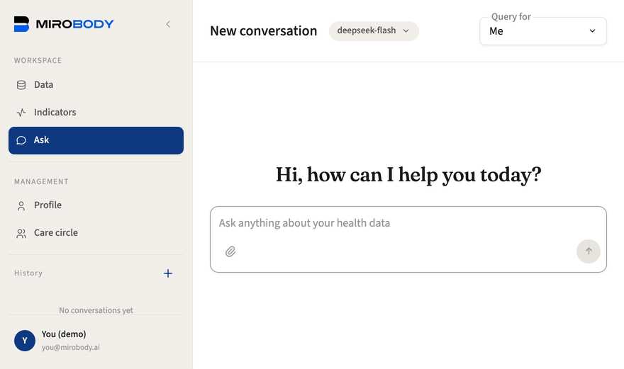
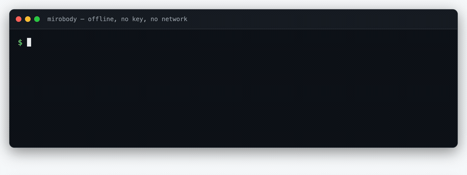
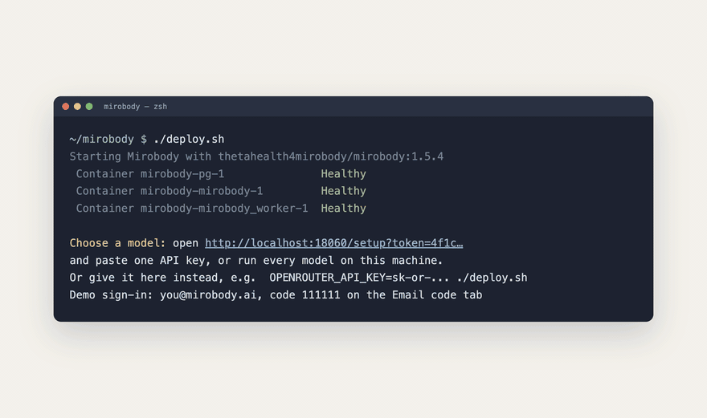
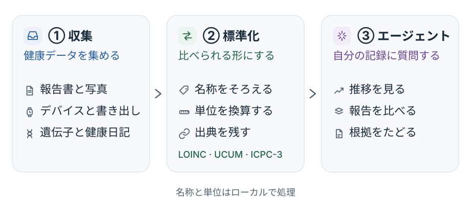
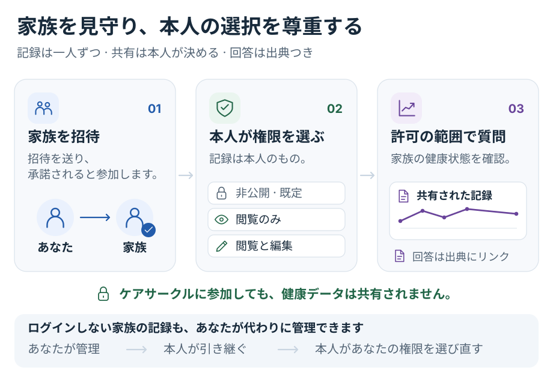

<div align="center">

<picture>
  <source media="(prefers-color-scheme: dark)" srcset="docs/images/mirobody-icon-dark.svg">
  
</picture>

# Mirobody

**あなたのからだを、データに映す。**

ひとつの標準で、あらゆる情報源をまとめ、あなたの全体像を映し出す。健康の行方を理解するための、長く続く記録です。<br>
このオープンソース版は、検査報告・ウェアラブル・遺伝子ファイルを手元のマシンで1つの標準化された記録にまとめ、すべての数値を出典までたどれるようにし、MCP で AI エージェントにつなぎます。<br>
健康データの標準化はコマンド1つで試せます。自分のモデルキーを使って Codespaces でアプリ全体を試すことも、アプリ・データ・モデルを 100% 手元のマシンで動かすこともできます。

**[English](README.md)** · **[中文](README.zh-CN.md)** · **日本語**

[](https://pypi.org/project/mirobody/)
[](LICENSE)
[](https://github.com/thetahealth/mirobody/stargazers)

**[▶ ライブデモ](https://chat.mirobody.ai/demo?ref=github-readme&lang=ja)** · **[コマンド1つで試す](#コマンド1つでエンジンを試す)** · **[Codespaces で開く](#codespaces-でアプリ全体を試す)** · **[100% ローカル](#すべてを-100-ローカルで動かす)**

</div>

<p align="center">
  
</p>
<p align="center"><em>3つの報告、同じ検査に3つの名前。それを1本の推移に。どの数値にも元のファイルが付いています。</em></p>

## 始め方を選ぶ

| やりたいこと | ここから | 必要なもの |
| --- | --- | --- |
| 名称と単位を標準化する | [コマンド1つ](#コマンド1つでエンジンを試す) | uv。モデルも API キーも不要 |
| ブラウザでアプリ全体を試す | [GitHub Codespaces](#codespaces-でアプリ全体を試す) | GitHub アカウントと、自分のモデル API キー |
| アプリ・モデル・記録をすべて手元に置く | [Docker で 100% ローカル](#すべてを-100-ローカルで動かす) | Compose 付きの Docker、メモリ 16 GB。API キー不要 |
| Docker を使わずに、アプリと記録を手元に置く | [Docker なし](#docker-なしで動かす) | Debian または Ubuntu、PostgreSQL 16、Python 3.12、自分のモデル API キー |
| 何も動かさずに、自分の記録で使う | [Theta Web](https://dr.thetahealth.ai/?utm_source=mirobody&utm_medium=github&utm_campaign=mirobody-to-theta&utm_content=readme) で Mirobody を試す（Theta のモバイルアプリでも利用可） | アカウント |

## コマンド1つでエンジンを試す

[uv をインストール](https://docs.astral.sh/uv/getting-started/installation/)したら、次のコマンドをターミナルに貼り付けてください：

```bash
uvx --python 3.12 mirobody resolve "LDL cholesterol" 血红蛋白 ヘモグロビン "Total Kolesterol" 血脂
```

リポジトリのクローンも、Docker も、モデルも API キーも要りません。Python とパッケージは uv が用意します。初回だけはダウンロードのためにネットワーク接続が必要で、その後のリゾルバは同梱の語彙を使ってオフラインで動きます。

中国語の `血红蛋白` と日本語の `ヘモグロビン` は、どちらも `718-7` になります。`血脂`（中国語で「血中脂質」）は未解決のままです。特定の1つの検査ではなく、カテゴリを指す名前だからです。アプリ全体でも、同じエンジンが名称と単位を標準化します。

<p align="center">
  
</p>

→ [Python や MCP からエンジンを使う](docs/quickstart.md#a--the-library)（英語）

## Codespaces でアプリ全体を試す

自分のモデル API キーを使って、ブラウザで Web アプリを動かします。環境は GitHub が用意するので、手元のコンピューターに Docker や Python を入れる必要はありません。

[](https://codespaces.new/thetahealth/mirobody?quickstart=1)

1. **Codespace を作成し、** ターミナルで自動セットアップが終わるのを待ちます。アプリ、Postgres、ワーカー、合成デモデータが起動します。
2. **ターミナルに表示されたセットアップリンクを開き、** 自分のモデル API キーを入力します。[OpenRouter](https://openrouter.ai/keys)、[OpenAI](https://platform.openai.com/api-keys)、[Gemini](https://aistudio.google.com/apikey)、[Anthropic](https://platform.claude.com/settings/keys)、DeepSeek、DashScope、または OpenAI 互換のゲートウェイが使えます。キーは実際のリクエストが成功してから保存されます。転送されたアプリのポートは、既定で非公開です。
3. **ログインします。** 「メールコード」タブで `you@mirobody.ai`、コード `111111` を使い、**「コレステロールはどう変化した？」** と聞いてみてください。デモには、あなたの記録と、閲覧のみで共有された `mom@mirobody.ai` の記録を合わせて **2,019 件の測定値** が入っています。
4. **合成サンプルをアップロードします。** 「データ」ページで [`demo/upload/`](demo/) のファイルをアップロードすると、新しい報告が記録に加わる様子を確認できます。お母さんの記録に切り替えて、もう一度聞くこともできます。

アプリと記録は GitHub のクラウドで動き、処理する文書と質問はモデルサービスに送られます。試すときは同梱の合成データを使ってください。Codespaces には[利用上限と課金](https://docs.github.com/en/billing/concepts/product-billing/github-codespaces)があり、モデルの利用料は各モデル提供元から請求されます。終わったら Codespace を停止してください。すべてを自分のマシンで管理したい場合は、次のローカル手順を使います。

## すべてを 100% ローカルで動かす

**アプリ、記録、モデルのすべてが手元のマシンで動きます。モデルの API キーは不要です。** Compose 付きの Docker がスタック全体と [llama.cpp](https://github.com/ggml-org/llama.cpp) を起動し、小型の回答モデルと文書読み取りモデルを動かします：

```bash
git clone --depth 1 https://github.com/thetahealth/mirobody.git && cd mirobody
COMPOSE_PROFILES=local-cpu ./deploy.sh
```

メモリは 16 GB、そのうち少なくとも 8 GB を Docker に割り当ててください。GPU は不要です。Windows では WSL 2 のターミナルでコマンドを実行します。初回起動時はコンテナイメージとモデルの重みをダウンロードするため、ネットワーク接続が必要です。レジストリに届かないネットワークでは、`deploy.sh` がその旨を表示してミラー経由で再試行します。`.env` の `DOCKER_MIRROR` で自分のミラーを指定できます。ダウンロードが済めば、文書の読み取り、標準化、回答はすべてローカルで動きます。CPU での回答には数分かかることがあります。GPU を使う方法は [Mac・NVIDIA・Windows の設定](docs/local-models.md)（英語）で説明しています。

スクリプトが表示するアプリのリンクを開きます。ローカルモデルは選択済みです。上と同じデモアカウントでログインし、質問するか、サンプルをアップロードしてください。ローカルモデルの選択肢は[モデルの選び方](docs/model-choice.md)（英語）で比較しています。

<p align="center">
  
</p>

**Docker でクラウドのモデルを使いたい場合は、** ローカルモデルのプロファイルを付けずに `./deploy.sh` を実行し、表示されたセットアップリンクに自分のモデルキーを貼り付けます。アプリと記録はホストに残り、文書と質問はモデルサービスが処理します。

チャットでの計算は、どのモデルでもローカルの Python が担い、クエリしたもとのデータをそのまま受け取ります。
オプションの計算ツールには、ローカルの Docker イメージとデーモンへの接続が必要です。ネイティブ環境とコンテナ環境での接続方法は
[セットアップとデータの流れ](docs/python-analysis.md)（英語）で説明しています。クエリビューに組み込まれた統計は、
この実行環境がなくても使えます。

→ [セルフホストガイド](https://docs.mirobody.ai/en/self-host) · [ウォークスルー](docs/walkthrough.md) · [サーバーへのデプロイ](https://docs.mirobody.ai/en/deployment/production)（いずれも英語）

## Docker なしで動かす

**コンテナを使わず、レジストリから何も取得しません。** Debian または Ubuntu では、pgvector 付きの PostgreSQL 16 をディストリビューション自身のパッケージから入れ、アプリはチェックアウトしたディレクトリから直接動きます。Codespaces の手順と同じインストールです：

```bash
git clone --depth 1 https://github.com/thetahealth/mirobody.git && cd mirobody
scripts/install_native.sh   # PostgreSQL、pgvector、Python パッケージ、.env
scripts/start_native.sh     # ワーカーとアプリ（ポート 18060）
```

表示されたリンクを開き、`you@mirobody.ai`、コード `111111` でログインします。デモの記録はすでに入っています。表示されたセットアップリンクでモデルキーを入れると、文書からの抽出と回答が使えるようになります。`install_native.sh` は `sudo` でシステムパッケージを入れ、`postgres` アカウント用の sudoers ルールを1つ書き込みます。どちらも実行中に表示されます。

ローカルモデルは Docker の手順にしかないため、こちらはモデルサービスを使って回答します。それ以外は[手元のマシンに残るもの](#手元のマシンに残るもの)の「ローカル Docker + モデルキー」と同じです。記録はいまインストールした PostgreSQL に保存され、名称からコードへの変換がマシンの外に出ることはありません。

## できること

- **検査機関をまたいで報告を比べる。** PDF、スマートフォンの写真、スプレッドシートなど、23 種類のファイルが1つの履歴にまとまります。どの測定値も、読み取ったページにリンクしています。
- **日々のデータを取り込む。** Apple Health の書き出しデータを読み込んだり、Garmin、Oura、Whoop と連携したりできます。
- **家族を見守る。** 自分の記録を共有してくれる家族を招待したり、ログインしない親の記録を代わりに管理したりできます。
- **健康日記をつける。** `headache since last night, BP 150/95, no fever`（昨夜から頭痛、血圧 150/95、熱なし）は、コード化された症状1件とコード化された測定値2件になります。「no fever」が発熱として記録されることはありません。
- **遺伝子データを調べる。** 23andMe、AncestryDNA、WeGene の書き出しデータや VCF をアップロードし、rsID、遺伝子、領域で質問できます。薬に関する質問には CPIC の対応状況を示し、服薬の変更を勧めることはありません。
- **自分のエージェントを使う。** MCP で Claude Code、Codex、Cursor をつないだり、オフラインのエンジンを Python に組み込んだりできます。

## 収集 · 標準化 · エージェント

<p align="center">
<picture>
  <source media="(prefers-color-scheme: dark)" srcset="docs/images/collect-standardize-agent-dark.ja.svg">
  
</picture>
</p>

| 段階 | 何をするか | 場所 |
| --- | --- | --- |
| **① 収集 Collect** | ファイル、デバイス、日記を取り込みます。出どころを残すので、どの測定値も元までたどれます。 | [`collect/`](mirobody/collect/) |
| **② 標準化 Standardize** | `A1c`、`HbA1c`、`ヘモグロビンA1c` を同じコードに、単位を1つの標準にそろえます。すべてオフラインです。特定できない名前は未解決のまま残します。 | [`engine/`](mirobody/engine/) · [`standardize/`](mirobody/standardize/) |
| **③ エージェント Agent** | コード化された記録に質問します。推移、検査機関やデバイスをまたいだ比較、グラフ、そしてどの数値にも元のファイル。 | [`agent/`](mirobody/agent/) |

モデルは文書を読み、推論します。コードと単位はパッケージに同梱された語彙から来るもので、モデルが生成することはありません。[測定値がパイプラインをどう通るか](docs/pipeline.md)（英語）。

## 家族を見守る

<p align="center">
  <picture>
    <source media="(max-width: 640px) and (prefers-color-scheme: dark)" srcset="docs/images/care-circle-sharing-mobile-dark.ja.svg">
    <source media="(max-width: 640px)" srcset="docs/images/care-circle-sharing-mobile.ja.svg">
    <source media="(prefers-color-scheme: dark)" srcset="docs/images/care-circle-sharing-dark.ja.svg">
    
  </picture>
</p>

ケアサークルに参加しただけでは、何も共有されません。自分の記録の閲覧や編集をほかのメンバーに許すかどうかは、メンバー一人ひとりが決めます。ログインしない親の記録はあなたが管理でき、本人が記録を引き継いだあとは、あなたに残す権限を本人が選びます。[ウォークスルーで見る](docs/walkthrough.md)（英語）。

## 手元のマシンに残るもの

アプリをどこで動かすかと、モデルをどこで動かすかは、別々に選べます。Mirobody が利用状況をどこかへ送信することはありません。

| | Codespaces + モデルキー | ローカル Docker + モデルキー | 100% このマシン |
| --- | --- | --- | --- |
| アプリと保存された記録 | GitHub クラウド上の Codespace | 手元のマシン | 手元のマシン |
| モデルで処理する文書と質問 | モデル提供元に送信（提供元の規約に従う） | モデル提供元に送信（提供元の規約に従う） | 手元のマシンに留まる |
| 名称からコード、単位から UCUM へ（**② 標準化**） | Codespace 内で、同梱の語彙から | 手元のマシンで、ネットワークなし | 手元のマシンで、ネットワークなし |
| モデルの重み | モデル提供元が管理 | モデル提供元が管理 | Hugging Face から一度だけダウンロード |

コマンドラインのリゾルバも、最初のダウンロードが済めば、モデルもネットワークも使わずに手元で動きます。

デバイスのベンダーがデータを受け取るのは、あなたがそのデバイスを連携したあとだけです。自分で管理していないネットワークに公開する前に、[SECURITY.md](SECURITY.md)（英語）を読んでください。サーバーが通信しうる宛先をすべて列挙しています。

## Mirobody を使って開発する

| やりたいこと | ここから |
| --- | --- |
| Claude Code、Codex、Cursor、Gemini CLI で自分の記録を使う | **設定 → MCP リンク** のあと、[クライアントごとの1行設定](https://docs.mirobody.ai/en/tools/mcp-integration)（英語） |
| 自分のコードで名称と単位を解決する | `pip install mirobody`：オフライン、キー不要、依存は numpy だけ（[ライブラリガイド](docs/quickstart.md#a--the-library)、英語） |
| コーディングエージェントにこの手順を教える | `npx skills add thetahealth/mirobody --skill standardize-health-data`（[skills](skills/README.md)） |
| デバイスのプロバイダーやツールを追加する | `mirobody/collect/providers/` か `mirobody/agent/tools/` にファイルを置く（[CONTRIBUTING](CONTRIBUTING.md)） |
| デプロイせずにアプリを試す | [Mirobody Web デモ](https://chat.mirobody.ai/demo?ref=github-readme&lang=ja)。同じ[合成デモファイル](demo/README.md)を使っています |

MCP では7つのツールが使え、どれもログイン中の本人の範囲に限られます。4つは記録を読み（測定値、服薬、遺伝子型、ファーマコゲノミクス）、3つは名称と単位を解決します。

`pip install mirobody` のあと、同じエンジンを Python から使えます：

```python
from mirobody.engine import resolve, resolve_reading

resolve("ヘモグロビン").loinc                                 # '718-7'   どの言語でも同じコード
resolve_reading("総コレステロール", "5.0", "mmol/L").loinc    # '14647-2' 単位がコードを決める……
resolve_reading("総コレステロール", "193", "mg/dL").loinc     # '2093-3'  ……モル濃度ではなく質量濃度
resolve("空腹時血糖").loinc                                   # '1558-6'  Fasting glucose
resolve("血脂").resolved                                     # False    1つの検査ではなくカテゴリ
```

### 確かめられる数字

| 主張 | 確かめ方 |
| --- | --- |
| 一般的な健康診断に載る検査名で **345/345**（英語、中国語、日本語、ロシア語、エストニア語、トルコ語） | [`test_engine_coverage.py`](mirobody/tests/test_engine_coverage.py) がスコアを表示します |
| 次元解析つきの **UCUM 単位 330 個**と、デバイス・臨床検査指標の**カタログ項目 543 件** | [標準化の詳細](docs/standardization.md) · [デバイス対応表](docs/device-crosswalk.md)（英語） |
| パッケージは自分の語彙を名乗ります：`mirobody.BUNDLE_VERSION` は `loinc-2.83+2026.09.17-aacb2c715b56` | `python -c "import mirobody; print(mirobody.BUNDLE_VERSION)"` |
| 公開している健康エージェントのベンチマーク：[ESL-Bench](https://huggingface.co/datasets/mirobody/ESL-Bench)、[MedHall-Bench](https://huggingface.co/datasets/mirobody/MedHall-Bench)、[MedHarm-Bench](https://huggingface.co/datasets/mirobody/MedHarm-Bench) | [`mirobody-eval`](https://github.com/thetahealth/mirobody-eval) · [`benchmarks/`](benchmarks/README.md) |

Mirobody は、Web とモバイルで提供中の個人向け健康アプリ [Theta](https://www.thetahealth.ai/) のエンジンでもあります。現在の利用者数：<br>
[](https://www.thetahealth.ai/) [](https://www.thetahealth.ai/)

## コントリビューション

いちばん役に立つのは、リゾルバが間違える用語を見つけることです。`mirobody resolve "<用語>"` を実行し、答えが間違っているか空なら、[報告する](https://github.com/thetahealth/mirobody/issues/new?template=wrong-term.yml)か、テストケースを添えて修正を送ってください。語彙はこうして新しい言語に広がってきました。ロシア語の検査項目とエストニア語のビタミンの表記は [#88](https://github.com/thetahealth/mirobody/pull/88)、トルコ語の検査報告の表記は [#140](https://github.com/thetahealth/mirobody/pull/140) で加わり、どれも用語ごとに [`resolver_overrides.tsv`](mirobody/res/loinc/resolver_overrides.tsv) の1行とテストケース1つです。環境の準備とチェックの手順は [CONTRIBUTING.md](CONTRIBUTING.md)（英語）にあります。

[HL7 FHIR](https://hl7.org/fhir/)、[Regenstrief Institute](https://www.regenstrief.org/) の [LOINC](https://loinc.org/)、[UCUM](https://ucum.org/)、[ICPC-3](https://icpc-3.info/)（WONCA）、[CPIC](https://cpicpgx.org/)、[llama.cpp](https://github.com/ggml-org/llama.cpp)、[deepagents](https://github.com/langchain-ai/deepagents) の上に作られています。感謝します。用語体系のライセンスは [`LICENSE-3RD-PARTY`](LICENSE-3RD-PARTY) を参照してください。

<div align="center">

**Mirobody で検査結果が読み解けたなら、Star を付けてください。次の誰かが見つけやすくなります。**

<a href="https://www.star-history.com/#thetahealth/mirobody&Date">
  <picture>
    <source media="(prefers-color-scheme: dark)" srcset="https://api.star-history.com/svg?repos=thetahealth/mirobody&type=Date&theme=dark" />
    <source media="(prefers-color-scheme: light)" srcset="https://api.star-history.com/svg?repos=thetahealth/mirobody&type=Date" />
    
  </picture>
</a>

[ドキュメント](docs/README.md) · [ロードマップ](docs/roadmap.md) · [変更履歴](CHANGELOG.md) · [セキュリティ](SECURITY.md) · [AGENTS.md](AGENTS.md)（いずれも英語）

Apache 2.0 · © 2026 [Theta Health](https://thetahealth.ai)

</div>

<!-- mcp-name: ai.thetahealth/mirobody -->
