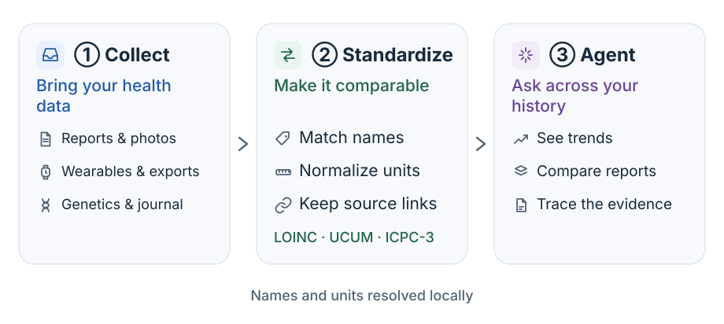
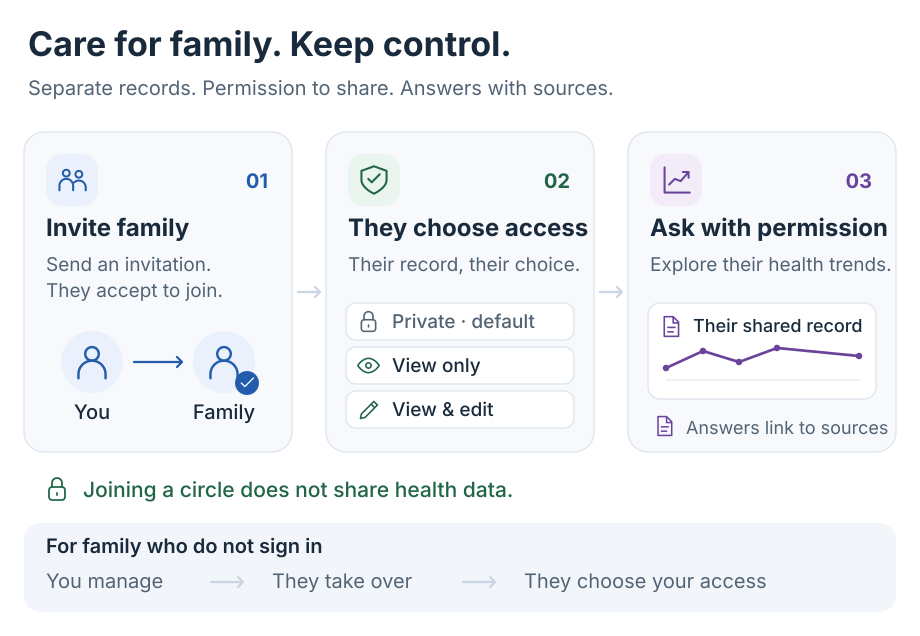

<div align="center">

<picture>
  <source media="(prefers-color-scheme: dark)" srcset="docs/images/mirobody-icon-dark.svg">
  
</picture>

# Mirobody

**Turn scattered health data into answers you can trace.**

A self-hosted AI health data engine that brings lab reports, wearables and genetic files into one standardized record.<br>
Standardize health data with one command. Try the full app in Codespaces with your own model key, or run the app, the data and the models 100% on your own machine.

**English** · **[中文](README.zh-CN.md)** · **[日本語](README.ja.md)**

[](https://pypi.org/project/mirobody/)
[](LICENSE)
[](https://github.com/thetahealth/mirobody/stargazers)

**[▶ Live demo](https://chat.mirobody.ai/demo?ref=github-readme&lang=en)** · **[Try one command](#try-the-engine-with-one-command)** · **[Open in Codespaces](#try-the-full-app-in-codespaces)** · **[100% local](#run-everything-100-locally)**

</div>

<p align="center">
  
</p>
<p align="center"><em>Three reports, three names for the same test. One trend, with the file behind every number.</em></p>

## Choose where to start

| You want to | Start here | What you need |
| --- | --- | --- |
| Standardize names and units | [One command](#try-the-engine-with-one-command) | uv; no model or API key |
| Try the full app in your browser | [GitHub Codespaces](#try-the-full-app-in-codespaces) | A GitHub account and your own model API key |
| Keep the app, models and records on your machine | [100% local with Docker](#run-everything-100-locally) | Docker with Compose; 16 GB memory; no API key |
| Keep the app and records on your machine, without Docker | [No Docker](#run-without-docker) | Debian or Ubuntu; PostgreSQL 16; Python 3.12; your own model API key |
| Use it on your own records with nothing to run | [Theta](https://dr.thetahealth.ai/en/login?utm_source=mirobody&utm_medium=github&utm_campaign=mirobody-to-theta&utm_content=readme), built on Mirobody, on the web or as a mobile app | An account |

## Try the engine with one command

With [uv installed](https://docs.astral.sh/uv/getting-started/installation/), paste this into your terminal:

```bash
uvx --python 3.12 mirobody resolve "LDL cholesterol" 血红蛋白 ヘモグロビン "Total Kolesterol" 血脂
```

No repository clone, Docker, model or API key. uv prepares Python and the package for you; the first run needs a network connection to download them. The resolver then works offline from the bundled vocabulary.

`血红蛋白` and `ヘモグロビン` both resolve to `718-7`. `血脂` stays unresolved: it names a category, not one test. The same engine standardizes names and units across the full app.

<p align="center">
  
</p>

→ [Use the engine from Python or MCP](docs/quickstart.md#a--the-library)

## Try the full app in Codespaces

Run the web app in your browser with your own model API key. GitHub prepares the environment; you do not need to install Docker or Python on your computer.

[](https://codespaces.new/thetahealth/mirobody?quickstart=1)

1. **Create the codespace** and wait for the automatic setup to finish in its terminal. It starts the app, Postgres, the worker and the synthetic demo data.
2. **Open the setup link printed in the terminal** and enter your own model API key: [OpenRouter](https://openrouter.ai/keys), [OpenAI](https://platform.openai.com/api-keys), [Gemini](https://aistudio.google.com/apikey), [Anthropic](https://platform.claude.com/settings/keys), DeepSeek, DashScope, or any OpenAI-compatible gateway. The key is saved only after a real request succeeds. The forwarded app port is private by default.
3. **Sign in** as `you@mirobody.ai`, code `111111`, on the Email code tab. Ask **"How has my cholesterol changed?"** The demo holds **2,019 readings** across your record and `mom@mirobody.ai`'s, shared with you view-only.
4. **Upload a synthetic sample** from [`demo/upload/`](demo/) on the Data page to see a new report join the record, or switch to mom's record and ask again.

The app and its records run in GitHub's cloud; the model service receives the documents and questions it processes. Use the included synthetic data to explore. Codespaces has [usage limits and billing](https://docs.github.com/en/billing/concepts/product-billing/github-codespaces); model usage is billed by your model provider. Stop the codespace when you finish. For complete control on your own machine, use the local route below.

## Run everything 100% locally

**The app, records and models all run on your own machine. No model API key needed.** Docker with Compose starts the stack and [llama.cpp](https://github.com/ggml-org/llama.cpp), with a small answering model and a document reader:

```bash
git clone --depth 1 https://github.com/thetahealth/mirobody.git && cd mirobody
COMPOSE_PROFILES=local-cpu ./deploy.sh
```

Allow 16 GB of memory, at least 8 GB of it for Docker. No GPU is required; on Windows, run the commands in a WSL 2 terminal. The first start needs a network connection to download container images and model weights. If the registry is not reachable from your network, `deploy.sh` says so and retries through a mirror; `DOCKER_MIRROR` in `.env` names your own. After those downloads, document reading, standardization and answers run locally. CPU answers can take minutes; [Mac, NVIDIA and Windows options](docs/local-models.md) explain how to use your GPU.

Open the app link the script prints. The local models are already selected; sign in with the same demo account above, ask a question or upload a sample. [Which model to choose](docs/model-choice.md) compares the local options.

<p align="center">
  
</p>

**Prefer Docker with a cloud model?** Run `./deploy.sh` without a local model profile, then paste your own model key into the printed setup link. The app and records stay on your host; the model service processes your documents and questions.

Chat calculations use local Python for every model, taking original queried
data directly. The optional calculator needs a local Docker image and daemon
connection; [setup and data flow](docs/python-analysis.md) cover native and
containerized applications. Query views provide their built-in statistics
without that executor.

→ [Self-host guide](https://docs.mirobody.ai/en/self-host) · [Walkthrough](docs/walkthrough.md) · [Deploy on a server](https://docs.mirobody.ai/en/deployment/production)

## Run without Docker

**No container, and nothing pulled from a registry.** On Debian or Ubuntu, PostgreSQL 16 with pgvector comes from the distribution's own packages and the app runs straight from the checkout. It is the same install the Codespaces path performs:

```bash
git clone --depth 1 https://github.com/thetahealth/mirobody.git && cd mirobody
scripts/install_native.sh   # PostgreSQL, pgvector, the Python package, a .env
scripts/start_native.sh     # the worker and the app on port 18060
```

Open the link it prints and sign in as `you@mirobody.ai`, code `111111`: the demo record is seeded already. A model key from the printed setup link adds document extraction and answers. `install_native.sh` installs system packages with `sudo` and writes one sudoers rule for the `postgres` account, and says so as it runs.

The local models belong to the Docker path, so this one answers through a model service. Everything else matches the row above it in [what stays on your machine](#what-stays-on-your-machine): the records live in the PostgreSQL you just installed, and a name to a code never leaves the machine.

## What you can do

- **Compare reports across labs.** PDFs, phone photos and spreadsheets, 23 file types in all, land in one history. Every reading links to the page it was read from.
- **Bring in everyday data.** Import an Apple Health export, or connect Garmin, Oura and Whoop.
- **Look after your family.** Invite someone who shares their own record, or keep one for a parent who never signs in.
- **Write a health journal.** `headache since last night, BP 150/95, no fever` becomes a coded complaint and two coded readings; "no fever" is not logged as a fever.
- **Explore genetic data.** Upload a 23andMe, AncestryDNA or WeGene export, or a VCF, and ask by rsID, gene or region. Drug questions get CPIC coverage, never a change of medication.
- **Use your own agent.** Connect Claude Code, Codex or Cursor over MCP, or embed the offline engine in Python.

## Collect · Standardize · Agent

<p align="center">
<picture>
  <source media="(prefers-color-scheme: dark)" srcset="docs/images/collect-standardize-agent-dark.svg">
  
</picture>
</p>

| Stage | What it does | Where |
| --- | --- | --- |
| **① Collect** | Files, devices and journal entries come in; the source is kept, so every reading points back to it. | [`collect/`](mirobody/collect/) |
| **② Standardize** | `A1c`, `HbA1c` and `Glycated Hemoglobin` resolve to one code, units to one standard, offline. A name it cannot place stays unresolved. | [`engine/`](mirobody/engine/) · [`standardize/`](mirobody/standardize/) |
| **③ Agent** | Ask over the coded record: trends, comparisons across labs and devices, a chart, and the file behind every number. | [`agent/`](mirobody/agent/) |

The model reads documents and reasons; the codes and units come from vocabularies bundled with the package, never from the model. [How a reading moves through the pipeline](docs/pipeline.md).

## Care for your family

<p align="center">
  <picture>
    <source media="(max-width: 640px) and (prefers-color-scheme: dark)" srcset="docs/images/care-circle-sharing-mobile-dark.svg">
    <source media="(max-width: 640px)" srcset="docs/images/care-circle-sharing-mobile.svg">
    <source media="(prefers-color-scheme: dark)" srcset="docs/images/care-circle-sharing-dark.svg">
    
  </picture>
</p>

Joining a care circle shares nothing by itself. Each member decides whether others may view or edit their own record. A parent who never signs in can be managed by you until they claim the record and choose what you keep. [See it in the walkthrough](docs/walkthrough.md).

## What stays on your machine

Where the app runs and where the model runs are separate choices. Mirobody does not report usage anywhere.

| | Codespaces + a model key | Local Docker + a model key | 100% on this machine |
| --- | --- | --- | --- |
| App and stored records | in your codespace on GitHub's cloud | on your machine | on your machine |
| Documents and questions sent for model processing | sent to your model vendor, under its terms | sent to your model vendor, under its terms | stay on your machine |
| A name to a code, a unit to UCUM (**② Standardize**) | in the codespace, from the bundled vocabulary | on your machine, with no network | on your machine, with no network |
| Model weights | managed by the model vendor | managed by the model vendor | downloaded once from Hugging Face |

The command-line resolver also runs on your machine without a model or network access after its initial download.

Device vendors see data only after you link one. Before this reaches a network you do not control, read [SECURITY.md](SECURITY.md): it lists every address the server can call.

## Build on Mirobody

| You want | Start here |
| --- | --- |
| Your record in Claude Code, Codex, Cursor or Gemini CLI | **Settings → MCP link**, then [one line per client](https://docs.mirobody.ai/en/tools/mcp-integration) |
| Names and units resolved in your own code | `pip install mirobody`: offline, no key, numpy the only dependency ([library guide](docs/quickstart.md#a--the-library)) |
| Your coding agent taught the workflow | `npx skills add thetahealth/mirobody --skill standardize-health-data` ([skills](skills/README.md)) |
| A new device provider or tool | Drop a file into `mirobody/collect/providers/` or `mirobody/agent/tools/` ([CONTRIBUTING](CONTRIBUTING.md)) |
| Try the app without deploying | [Mirobody Web demo](https://chat.mirobody.ai/demo?ref=github-readme&lang=en), using the same [synthetic demo files](demo/README.md) |

Over MCP the stack serves seven tools, each scoped to the signed-in person: four read your record (readings, medications, genotypes, pharmacogenomics) and three resolve names and units.

After `pip install mirobody`, use the same engine from Python:

```python
from mirobody.engine import resolve, resolve_reading

resolve("血红蛋白").loinc                                     # '718-7'   any language, one code
resolve_reading("total cholesterol", "5.0", "mmol/L").loinc  # '14647-2' the unit picks the code...
resolve_reading("total cholesterol", "193", "mg/dL").loinc   # '2093-3'  ...mass, not moles
resolve("中性粒细胞百分比").loinc                               # '26511-6' Neutrophils/Leukocytes
resolve("血脂").resolved                                     # False    a category, not one test
```

### Numbers you can check

| Claim | Check it |
| --- | --- |
| **345/345** on the tests an ordinary checkup prints, in English, Chinese, Japanese, Russian, Estonian and Turkish | [`test_engine_coverage.py`](mirobody/tests/test_engine_coverage.py) prints the score |
| **330 UCUM units** with dimensional analysis, and **316 standard device indicators** | [Standardization](docs/standardization.md) · [Device crosswalk](docs/device-crosswalk.md) |
| The package names its vocabulary: `mirobody.BUNDLE_VERSION` is `loinc-2.83+2026.09.17-aacb2c715b56` | `python -c "import mirobody; print(mirobody.BUNDLE_VERSION)"` |
| Public health-agent benchmarks: [ESL-Bench](https://huggingface.co/datasets/mirobody/ESL-Bench), [MedHall-Bench](https://huggingface.co/datasets/mirobody/MedHall-Bench), [MedHarm-Bench](https://huggingface.co/datasets/mirobody/MedHarm-Bench) | [`mirobody-eval`](https://github.com/thetahealth/mirobody-eval) · [`benchmarks/`](benchmarks/README.md) |

Mirobody is the engine under [Theta Wellness](https://www.thetahealth.ai/), a live consumer health app on the web and mobile.

## Contributing

The most useful contribution is a term the resolver gets wrong. Run `mirobody resolve "<term>"`; if the answer is wrong or empty, [report it](https://github.com/thetahealth/mirobody/issues/new?template=wrong-term.yml) or send a fix with a test case. That is how the vocabulary grows into new languages: Russian panel and Estonian vitamin terms arrived in [#88](https://github.com/thetahealth/mirobody/pull/88) and Turkish lab-report spellings in [#140](https://github.com/thetahealth/mirobody/pull/140), each one row of [`resolver_overrides.tsv`](mirobody/res/loinc/resolver_overrides.tsv) and one test case per term. [CONTRIBUTING.md](CONTRIBUTING.md) has the setup and the checks.

Built on [HL7 FHIR](https://hl7.org/fhir/), [LOINC](https://loinc.org/) from the [Regenstrief Institute](https://www.regenstrief.org/), [UCUM](https://ucum.org/), [ICPC-3](https://icpc-3.info/) (WONCA), [CPIC](https://cpicpgx.org/), [llama.cpp](https://github.com/ggml-org/llama.cpp) and [deepagents](https://github.com/langchain-ai/deepagents), with thanks. Terminology licences: [`LICENSE-3RD-PARTY`](LICENSE-3RD-PARTY).

<div align="center">

**If Mirobody helped you make sense of a report, a star helps the next person find it.**

<a href="https://www.star-history.com/#thetahealth/mirobody&Date">
  <picture>
    <source media="(prefers-color-scheme: dark)" srcset="https://api.star-history.com/svg?repos=thetahealth/mirobody&type=Date&theme=dark" />
    <source media="(prefers-color-scheme: light)" srcset="https://api.star-history.com/svg?repos=thetahealth/mirobody&type=Date" />
    
  </picture>
</a>

[Documentation](docs/README.md) · [Roadmap](docs/roadmap.md) · [Changelog](CHANGELOG.md) · [Security](SECURITY.md) · [AGENTS.md](AGENTS.md)

Apache 2.0 · © 2026 [Theta Health](https://thetahealth.ai)

</div>

<!-- mcp-name: ai.thetahealth/mirobody -->
