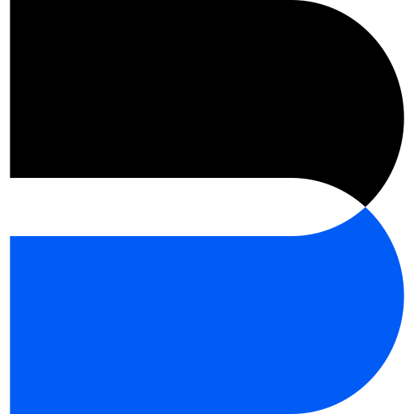
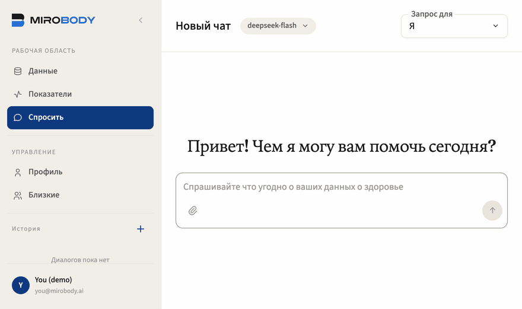
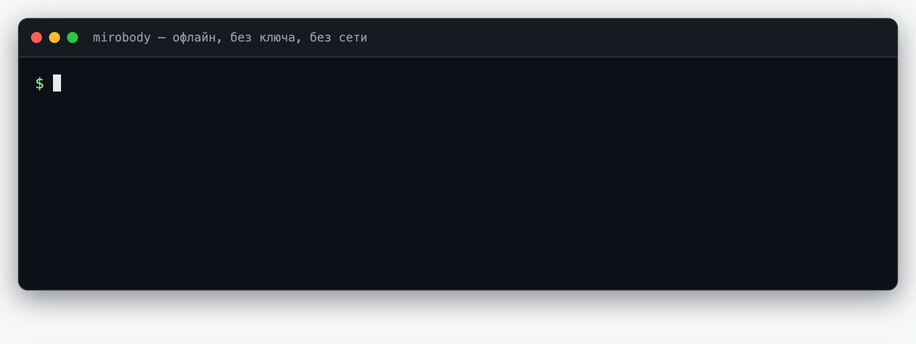
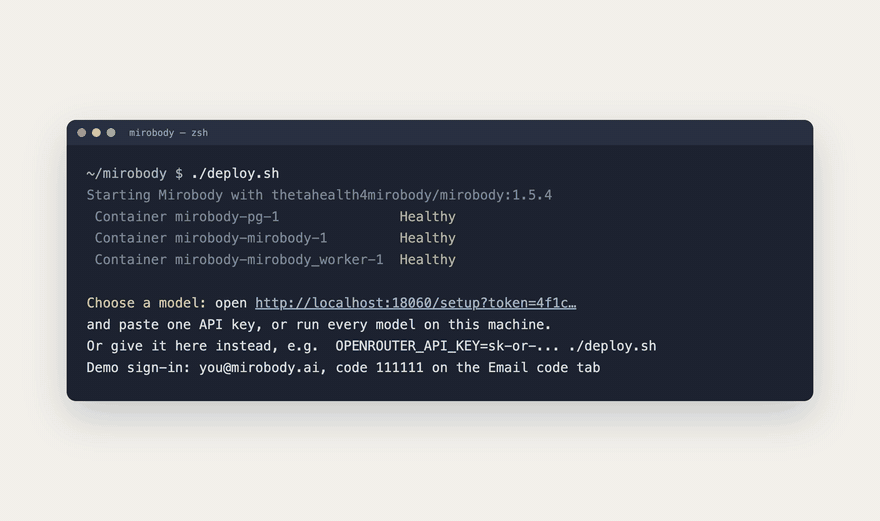
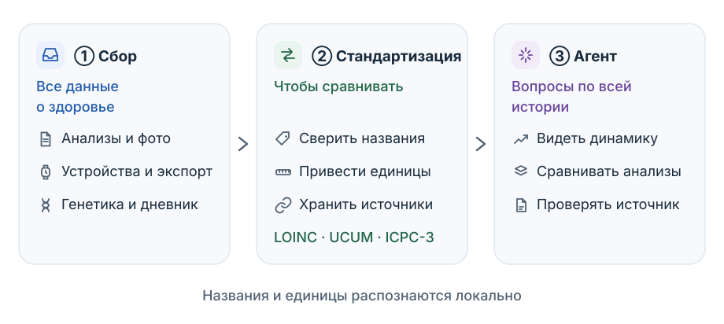
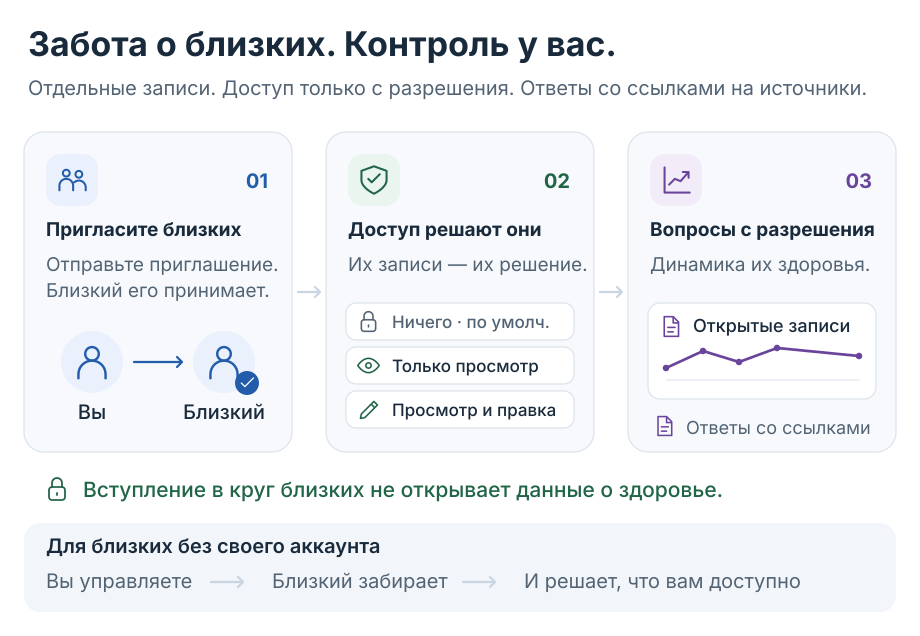

<div align="center">

<picture>
  <source media="(prefers-color-scheme: dark)" srcset="docs/images/mirobody-icon-dark.svg">
  
</picture>

# Mirobody

**Зеркало вашего тела в данных.**

Один стандарт, все источники, полная картина вашего здоровья — долговременная медицинская карта, по которой видно, куда оно движется.<br>
Эта открытая версия хранит карту на вашем компьютере: в неё стекаются результаты анализов, данные носимых устройств и генетические файлы, а ваш ИИ-агент может обращаться к ней по MCP.

**[English](README.md)** · **[中文](README.zh-CN.md)** · **[日本語](README.ja.md)** · **Русский**

<sub>Веб-приложение, записи экрана и диаграммы на этой странице — на русском. Руководства, на которые она ссылается, пока только на английском.</sub>

[](https://pypi.org/project/mirobody/)
[](LICENSE)
[](https://github.com/thetahealth/mirobody/stargazers)

**[▶ Онлайн-демо](https://chat.mirobody.ai/demo?ref=github-readme&lang=en)** · **[Одна команда](#попробуйте-движок-одной-командой)** · **[Открыть в Codespaces](#попробуйте-всё-приложение-в-codespaces)** · **[100% локально](#всё-на-100-локально)**

</div>

<p align="center">
  
</p>
<p align="center"><em>Три отчёта — три названия одного анализа. Один тренд, и за каждым числом — исходный файл.</em></p>

## Выберите, с чего начать

| Что вы хотите | С чего начать | Что нужно |
| --- | --- | --- |
| Стандартизировать названия и единицы в терминале или в своём ИИ-агенте | [Одна команда](#попробуйте-движок-одной-командой) | uv; ни модели, ни API-ключа |
| Попробовать всё приложение в браузере | [GitHub Codespaces](#попробуйте-всё-приложение-в-codespaces) | Аккаунт GitHub и собственный API-ключ модели |
| Держать приложение, модели и данные на своём компьютере | [100% локально через Docker](#всё-на-100-локально) | Docker с Compose; 16 ГБ памяти; API-ключ не нужен |
| Держать приложение и данные на своём компьютере, без Docker | [Без Docker](#без-docker) | Debian или Ubuntu; PostgreSQL 16; Python 3.12; собственный API-ключ модели |
| Работать со своими данными, ничего не запуская | Mirobody в [Theta Web](https://dr.thetahealth.ai/?utm_source=mirobody&utm_medium=github&utm_campaign=mirobody-to-theta&utm_content=readme) или в мобильном приложении Theta | Аккаунт |

## Попробуйте движок одной командой

С [установленным uv](https://docs.astral.sh/uv/getting-started/installation/) вставьте в терминал:

```bash
uvx --python 3.12 mirobody resolve "LDL cholesterol" 血红蛋白 ヘモグロビン "Total Kolesterol" 血脂
```

Не нужны ни клон репозитория, ни Docker, ни модель, ни API-ключ. uv сам подготовит Python и пакет; для первого запуска нужна сеть, чтобы их скачать. Дальше распознаватель работает офлайн по встроенному словарю.

`血红蛋白` и `ヘモグロビン` дают один и тот же код `718-7`, как и русское `гемоглобин`. `血脂` остаётся нераспознанным: это категория, а не один анализ. Тот же движок стандартизирует названия и единицы во всём приложении.

<p align="center">
  
</p>

Подключите тот же движок к своему ИИ-агенту. В Claude Code:

```bash
claude mcp add mirobody -- uvx --python 3.12 mirobody mcp
```

В стандартном окне Windows PowerShell запускайте `claude.cmd` вместо `claude`
([почему](docs/quickstart.md#when-it-does-not-come-up)).

После этого агент сможет стандартизировать любое вставленное вами название, значение, единицу или жалобу — на вашем компьютере и без ключа. Чтобы прочитать целый отчёт, нужны ещё `mirobody[parse]` и ключ модели. [Другие MCP-клиенты](https://docs.mirobody.ai/en/tools/mcp-integration#local-terminology-over-stdio) используют ту же команду.

→ [Движок из Python или по MCP](docs/quickstart.md#a--the-library)

## Попробуйте всё приложение в Codespaces

Запустите веб-приложение в браузере со своим API-ключом модели. GitHub готовит окружение сам; устанавливать Docker или Python на компьютер не нужно.

[](https://codespaces.new/thetahealth/mirobody?quickstart=1)

1. **Создайте codespace** и дождитесь, пока в его терминале закончится автоматическая настройка. Она запускает приложение, Postgres, воркер и синтетические демо-данные.
2. **Откройте ссылку настройки из терминала** и введите свой API-ключ модели: [OpenRouter](https://openrouter.ai/keys), [OpenAI](https://platform.openai.com/api-keys), [Gemini](https://aistudio.google.com/apikey), [Anthropic](https://platform.claude.com/settings/keys), DeepSeek, DashScope или любой OpenAI-совместимый шлюз. Ключ сохраняется только после успешного настоящего запроса. Проброшенный порт приложения по умолчанию закрыт для других.
3. **Войдите** как `you@mirobody.ai` с кодом `111111` на вкладке «Код по почте»; язык интерфейса переключается на «Русский» на той же странице. Спросите **«Как менялся мой холестерин?»** В демо **2 019 измерений** — в вашей карте и в карте `mom@mirobody.ai`, открытой вам только для просмотра.
4. **Загрузите синтетический пример** из [`demo/upload/`](demo/) на странице «Данные», чтобы увидеть, как новый отчёт попадает в карту, или переключитесь на карту мамы и спросите ещё раз.

Приложение и его данные работают в облаке GitHub; сервис модели получает документы и вопросы, которые обрабатывает. Для знакомства используйте синтетические данные из репозитория. У Codespaces есть [лимиты и тарификация](https://docs.github.com/en/billing/concepts/product-billing/github-codespaces); за модель платите своему провайдеру. Остановите codespace, когда закончите. Полный контроль на своём компьютере даёт локальный вариант ниже.

## Всё на 100% локально

**Приложение, данные и модели работают на вашем компьютере. API-ключ модели не нужен.** Docker с Compose запускает стек и [llama.cpp](https://github.com/ggml-org/llama.cpp) с небольшой моделью для ответов и моделью для чтения документов:

```bash
git clone --depth 1 https://github.com/thetahealth/mirobody.git && cd mirobody
COMPOSE_PROFILES=local-cpu ./deploy.sh
```

Нужно 16 ГБ памяти, из них не меньше 8 ГБ для Docker. Видеокарта не нужна; в Windows выполняйте команды в терминале WSL 2. Для первого запуска нужна сеть, чтобы скачать образы контейнеров и веса моделей; если реестр недоступен, см. [вариант с зеркалом](docs/quickstart.md#when-it-does-not-come-up). После загрузки чтение документов, стандартизация и ответы работают локально. На CPU ответ может занять несколько минут; [настройки для Mac, NVIDIA и Windows](docs/local-models.md) объясняют, как задействовать видеокарту.

Откройте ссылку на приложение, которую выведет скрипт. Локальные модели уже выбраны; войдите с тем же демо-аккаунтом, задайте вопрос или загрузите пример. [Какую модель выбрать](docs/model-choice.md) — сравнение локальных вариантов.

<p align="center">
  
</p>

**Нужен Docker с облачной моделью?** Запустите `./deploy.sh` без профиля локальной модели и вставьте свой ключ модели по выведенной ссылке настройки. Приложение и данные остаются на вашем сервере; документы и вопросы обрабатывает сервис модели.

Вычисления в чате получают исходные запрошенные данные напрямую. Код облачной
модели выполняется как JavaScript внутри приложения, без какой-либо настройки;
модель на вашем оборудовании считает на Python в локальном Docker-контейнере,
если приложению доступен демон Docker. [Настройка и потоки данных](docs/python-analysis.md)
описывают оба варианта. Представления запросов дают встроенную статистику и без них.

→ [Руководство по развёртыванию у себя](https://docs.mirobody.ai/en/self-host) · [Пошаговый обзор](docs/walkthrough.md) · [Развёртывание на сервере](https://docs.mirobody.ai/en/deployment/production)

## Без Docker

**Ни контейнеров, ни загрузок из реестра.** В Debian или Ubuntu PostgreSQL 16 с pgvector ставится из пакетов самого дистрибутива, а приложение запускается прямо из клона репозитория. Ту же установку выполняет путь через Codespaces:

```bash
git clone --depth 1 https://github.com/thetahealth/mirobody.git && cd mirobody
scripts/install_native.sh   # PostgreSQL, pgvector, Python-пакет, файл .env
scripts/start_native.sh     # воркер и приложение на порту 18060
```

Откройте выведенную ссылку и войдите как `you@mirobody.ai` с кодом `111111`: демо-карта уже заполнена. Ключ модели, введённый по ссылке настройки, добавляет извлечение данных из документов и ответы. `install_native.sh` ставит системные пакеты через `sudo` и записывает одно правило sudoers для учётной записи `postgres` — и сообщает об этом по ходу работы.

Локальные модели есть только в варианте с Docker, поэтому здесь ответы даёт сервис модели. Всё остальное — как в столбце «Локальный Docker + ключ модели» в разделе [что остаётся на вашем компьютере](#что-остаётся-на-вашем-компьютере): данные хранятся в только что установленном PostgreSQL, а сопоставление названия с кодом никогда не покидает компьютер.

## Что можно делать

- **Сравнивайте отчёты разных лабораторий.** PDF, фото с телефона и таблицы — всего 23 типа файлов — попадают в одну историю. Каждое измерение ссылается на страницу, с которой оно прочитано.
- **Подключайте повседневные данные.** Импортируйте выгрузку Apple Health или подключите Garmin, Oura и Whoop.
- **Заботьтесь о семье.** Пригласите человека, который откроет вам свою карту, или ведите карту родителя, который никогда не входит в приложение.
- **Ведите дневник здоровья.** `headache since last night, BP 150/95, no fever` превращается в закодированную жалобу и два закодированных измерения; «no fever» не записывается как температура.
- **Изучайте генетические данные.** Загрузите выгрузку 23andMe, AncestryDNA или WeGene либо VCF и спрашивайте по rsID, гену или участку. На вопросы о лекарствах — соответствующие рекомендации [CPIC](https://cpicpgx.org/), но никогда не совет сменить лечение.
- **Используйте своего агента.** Подключите Claude Code, Codex или Cursor по MCP или встройте офлайн-движок в Python.

Mirobody не ставит диагнозы и не назначает лечение; его ответы не являются медицинской консультацией.

## Сбор · Стандартизация · Агент

<p align="center">
<picture>
  <source media="(prefers-color-scheme: dark)" srcset="docs/images/collect-standardize-agent-dark.ru.svg">
  
</picture>
</p>

| Этап | Что делает | Где |
| --- | --- | --- |
| **① Сбор** | Результаты анализов, данные устройств, фото, генетические файлы и записи дневника поступают из любых источников; каждое измерение хранит файл, из которого взято. | [`collect/`](mirobody/collect/) |
| **② Стандартизация** | `A1c`, `HbA1c` и `Glycated Hemoglobin` сводятся к одному коду, единицы — к одному стандарту, офлайн: измерения из разрозненных источников ложатся чистыми строками в одну таблицу. Название, которое не удаётся сопоставить, остаётся нераспознанным. | [`engine/`](mirobody/engine/) · [`standardize/`](mirobody/standardize/) |
| **③ Агент** | Ответы дают инструменты, которые запрашивают эту таблицу, а не память модели: тренды, сравнение лабораторий и устройств, график. Каждое число прослеживается до своего файла, так что его можно проверить, а не принимать на веру. | [`agent/`](mirobody/agent/) |

Модель читает документы и рассуждает; коды и единицы берутся из словарей, встроенных в пакет, а не из модели. [Как стандартизируется измерение, шаг за шагом](docs/site/standardization.md) · [Как измерение проходит через конвейер](docs/pipeline.md).

## Забота о близких

<p align="center">
  <picture>
    <source media="(max-width: 640px) and (prefers-color-scheme: dark)" srcset="docs/images/care-circle-sharing-mobile-dark.ru.svg">
    <source media="(max-width: 640px)" srcset="docs/images/care-circle-sharing-mobile.ru.svg">
    <source media="(prefers-color-scheme: dark)" srcset="docs/images/care-circle-sharing-dark.ru.svg">
    
  </picture>
</p>

Вступление в круг близких само по себе ничего не открывает. Каждый участник сам решает, могут ли другие просматривать или редактировать его карту. Карту родителя, который никогда не входит в приложение, можете вести вы, пока он не заберёт её и не решит, какой доступ вам оставить. [Посмотреть в обзоре](docs/walkthrough.md).

## Что остаётся на вашем компьютере

Где работает приложение и где работает модель — два отдельных выбора. Mirobody никуда не отправляет статистику использования.

| | Codespaces + ключ модели | Локальный Docker + ключ модели | 100% на этом компьютере |
| --- | --- | --- | --- |
| Приложение и сохранённые данные | в вашем codespace в облаке GitHub | на вашем компьютере | на вашем компьютере |
| Документы и вопросы, отправляемые модели | уходят провайдеру модели, на его условиях | уходят провайдеру модели, на его условиях | остаются на вашем компьютере |
| Название → код, единица → UCUM (**② Стандартизация**) | в codespace, по встроенному словарю | на вашем компьютере, без сети | на вашем компьютере, без сети |
| Веса модели | у провайдера модели | у провайдера модели | скачиваются один раз с Hugging Face |

Распознаватель в командной строке тоже работает на вашем компьютере — без модели и без сети после первой загрузки.

Производители устройств видят данные, только когда вы подключите их устройство. Прежде чем открывать приложение для сети, которую вы не контролируете, прочитайте [SECURITY.md](SECURITY.md): там перечислены все адреса, к которым может обращаться сервер.

## Создавайте на основе Mirobody

| Что вам нужно | С чего начать |
| --- | --- |
| Ваша карта в Claude Code, Codex, Cursor или Gemini CLI | В работающем приложении **Настройки → Ссылка MCP** (по умолчанию действует 10 дней), затем [по строке для каждого клиента](https://docs.mirobody.ai/en/tools/mcp-integration) |
| Офлайн-движок как инструменты в любом MCP-клиенте, без приложения | `uvx --python 3.12 mirobody mcp` по stdio ([настройка клиентов](https://docs.mirobody.ai/en/tools/mcp-integration#local-terminology-over-stdio)) |
| Mirobody внутри DeepSeek Harness | [dsh-plugin-mirobody](https://github.com/zwbao/dsh-plugin-mirobody), плагин сообщества от zwbao: офлайн-движок и инструменты только для чтения вашей карты, с вкладкой Mirobody |
| Распознавание названий и единиц в вашем коде | `pip install mirobody`: офлайн, без ключа, единственная зависимость — numpy ([руководство по библиотеке](docs/quickstart.md#a--the-library)) |
| Научить этому процессу своего агента-программиста | `npx skills add thetahealth/mirobody --skill standardize-health-data` ([навыки](skills/README.md)) |
| Новый провайдер устройств или инструмент | Добавьте файл в `mirobody/collect/providers/` или `mirobody/agent/tools/` ([CONTRIBUTING](CONTRIBUTING.md)) |
| Попробовать приложение без развёртывания | [Демо Mirobody Web](https://chat.mirobody.ai/demo?ref=github-readme&lang=en) на тех же [синтетических демо-файлах](demo/README.md) |

По MCP стек предоставляет инструменты в пределах прав вошедшего человека: четыре читают вашу карту (измерения, лекарства, генотипы, фармакогеномика), три распознают названия и единицы, и ещё два ищут медицинские справочные материалы, если у развёртывания есть источник знаний.

Stdio-сервер с каждым релизом публикуется в официальном реестре MCP как `ai.thetahealth/mirobody`. Каталоги, которые читают реестр, тоже его показывают — например, [mcprush](https://mcprush.com/thetahealth/mirobody-mcp) и [AddonAudit](https://addonaudit.com/addon/ai-thetahealth-mirobody/), который запускает его в песочнице. Каждый подхватывает новую версию по своему расписанию, поэтому строку установки берите из этого README.

После `pip install mirobody` тот же движок доступен из Python:

```python
from mirobody.engine import resolve, resolve_reading

resolve("гемоглобин").loinc                                    # '718-7'   любой язык, один код
resolve_reading("Холестерин общий", "5.0", "mmol/L").loinc     # '14647-2' код выбирает единица...
resolve_reading("Холестерин общий", "193", "mg/dL").loinc      # '2093-3'  ...массовая, а не молярная
resolve("Нейтрофилы (общ.число)").loinc                        # '770-8'   нейтрофилы/лейкоциты
resolve("血脂").resolved                                       # False    категория, а не один анализ
```

### Цифры, которые можно проверить

| Утверждение | Как проверить |
| --- | --- |
| **716/716** на анализах из обычного медосмотра — на английском, китайском, японском, русском, эстонском и турецком | [`test_engine_coverage.py`](mirobody/tests/test_engine_coverage.py) выводит результат |
| **63 416 кодов LOINC 2.83**, отобранных по правилам, и **1 023 273 названия**, указывающих на них, включая 21 язык самого LOINC; написания из отчётов, которых нет в индексе, добавляются по одной проверенной строке | [`fhir_loinc_bundle.NOTICE`](mirobody/res/loinc/fhir_loinc_bundle.NOTICE) · [`resolver_overrides.tsv`](mirobody/res/loinc/resolver_overrides.tsv) · [Как стандартизируется измерение](docs/site/standardization.md) |
| **331 единица UCUM** с анализом размерностей и **902 элемента каталога** показателей устройств и лабораторий | [Стандартизация](docs/standardization.md) · [Таблица соответствий устройств](docs/device-crosswalk.md) |
| Выгрузки 23andMe, AncestryDNA, WeGene, MyHeritage и FamilyTreeDNA и VCF на GRCh37 и GRCh38 дают **одни и те же 13 генотипов по 12 генам**; проверено на публичных образцах 1000 Genomes, которые входят в пакет | [`test_packaged_examples.py`](benchmarks/genomics/test_packaged_examples.py) · [Публичные примеры генотипов](mirobody/testing/genomics/README.md) |
| Пакет называет свой словарь: `mirobody.BUNDLE_VERSION` равен `loinc-2.83+2026.10.27-126ecba69782` | `python -c "import mirobody; print(mirobody.BUNDLE_VERSION)"` |
| Публичные бенчмарки для медицинских агентов: [ESL-Bench](https://huggingface.co/datasets/mirobody/ESL-Bench), [MedHall-Bench](https://huggingface.co/datasets/mirobody/MedHall-Bench), [MedHarm-Bench](https://huggingface.co/datasets/mirobody/MedHarm-Bench) | [`mirobody-eval`](https://github.com/thetahealth/mirobody-eval) · [`benchmarks/`](benchmarks/README.md) |

Mirobody — движок медицинских данных, на котором работает [Theta](https://www.thetahealth.ai/), действующее приложение о здоровье для веба и мобильных устройств.

## Участие в разработке

Самый полезный вклад — термин, который распознаватель понимает неправильно. Запустите `mirobody resolve "<термин>"`; если ответ неверный или пустой, [сообщите об этом](https://github.com/thetahealth/mirobody/issues/new?template=wrong-term.yml) или пришлите исправление с тестовым случаем. Так словарь и расширяется на новые языки: русские названия анализов и эстонские названия витаминов пришли в [#88](https://github.com/thetahealth/mirobody/pull/88), турецкие написания из лабораторных отчётов — в [#140](https://github.com/thetahealth/mirobody/pull/140); каждое — одна строка [`resolver_overrides.tsv`](mirobody/res/loinc/resolver_overrides.tsv) и один тестовый случай на термин. В [CONTRIBUTING.md](CONTRIBUTING.md) — настройка окружения и проверки.

Пишете о Mirobody? Записи экрана, диаграммы и скриншоты в [`docs/images`](./docs/images/README.md) распространяются по Apache-2.0 и готовы для статьи или поста; в указателе сказано, что показывает каждый файл.

Построено на [HL7 FHIR](https://hl7.org/fhir/), [LOINC](https://loinc.org/) от [Regenstrief Institute](https://www.regenstrief.org/), [UCUM](https://ucum.org/), [ICPC-3](https://icpc-3.info/) (WONCA), [CPIC](https://cpicpgx.org/), [llama.cpp](https://github.com/ggml-org/llama.cpp) и [deepagents](https://github.com/langchain-ai/deepagents) — спасибо им. Лицензии на терминологии: [`LICENSE-3RD-PARTY`](LICENSE-3RD-PARTY).

<div align="center">

**Если Mirobody помог вам разобраться в анализах, звезда поможет найти его следующему человеку.**

<a href="https://www.star-history.com/#thetahealth/mirobody&Date">
  <picture>
    <source media="(prefers-color-scheme: dark)" srcset="https://api.star-history.com/svg?repos=thetahealth/mirobody&type=Date&theme=dark" />
    <source media="(prefers-color-scheme: light)" srcset="https://api.star-history.com/svg?repos=thetahealth/mirobody&type=Date" />
    
  </picture>
</a>

[Документация](docs/README.md) · [Обсуждения](https://github.com/thetahealth/mirobody/discussions) · [Дорожная карта](docs/roadmap.md) · [Журнал изменений](CHANGELOG.md) · [Безопасность](SECURITY.md) · [AGENTS.md](AGENTS.md)

Apache 2.0 · © 2026 [Theta Health](https://thetahealth.ai)

</div>

<!-- mcp-name: ai.thetahealth/mirobody -->
