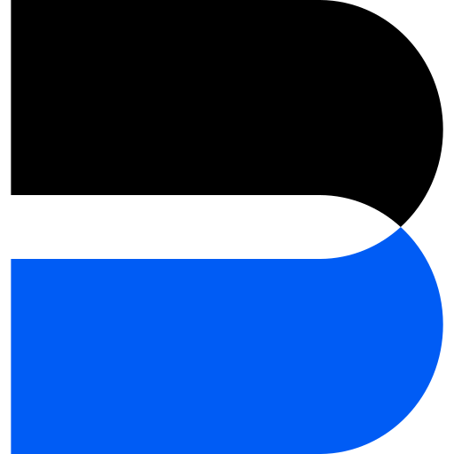
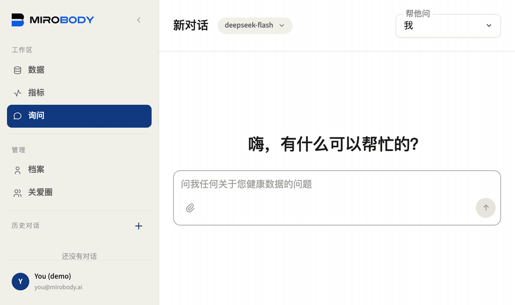
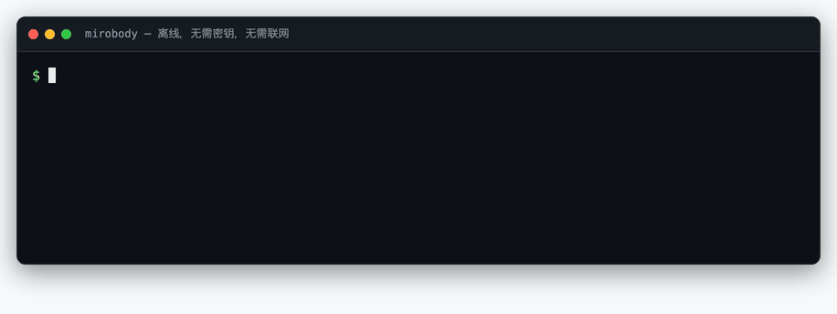
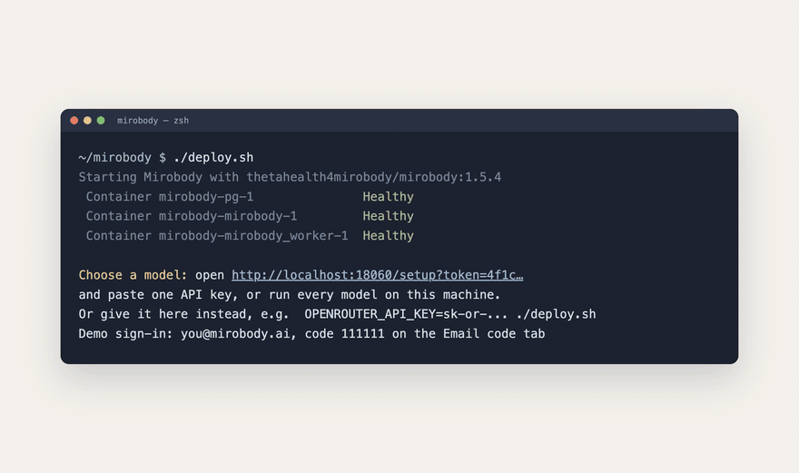
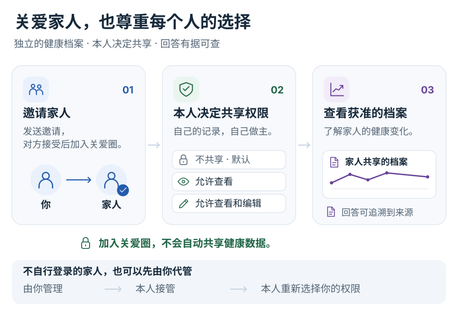

<div align="center">

<picture>
  <source media="(prefers-color-scheme: dark)" srcset="docs/images/mirobody-icon-dark.svg">
  
</picture>

# Mirobody

**把分散的健康数据，变成有据可查的答案。**

开源、自部署的 AI 健康数据引擎，把体检报告、可穿戴设备和基因数据汇成一份标准化的记录。<br>
一条命令体验健康数据标准化；在 Codespaces 填入自己的模型 Key，直接用浏览器体验完整应用；或让应用、数据和模型 100% 在本机运行。

**[English](README.md)** · **中文** · **[日本語](README.ja.md)**

[](https://pypi.org/project/mirobody/)
[](LICENSE)
[](https://github.com/thetahealth/mirobody/stargazers)

**[▶ 在线体验](https://chat.mirobody.cn/demo?ref=github-readme&lang=zh-cn)** · **[一条命令体验](#一条命令体验标准化引擎)** · **[在 Codespaces 中打开](#在-codespaces-体验完整应用)** · **[100% 本地部署](#100-本地部署应用数据和模型)**

</div>

<p align="center">
  
</p>
<p align="center"><em>不同医院，不同写法。放进同一条趋势，回看每个数值的来源。</em></p>

## 选一个适合你的入口

| 你想要 | 从这里开始 | 需要什么 |
| --- | --- | --- |
| 统一健康指标名称和单位 | [一条命令](#一条命令体验标准化引擎) | uv；不需要模型或 API Key |
| 在浏览器里体验完整应用 | [GitHub Codespaces](#在-codespaces-体验完整应用) | GitHub 账号和你自己的模型 API Key |
| 应用、模型和记录都留在自己机器上 | [Docker 100% 本地部署](#100-本地部署应用数据和模型) | 带 Compose 的 Docker；16 GB 内存；无需 API Key |
| 应用和记录留在自己机器上，且不用 Docker | [不用 Docker 运行](#不用-docker-运行) | Debian 或 Ubuntu；PostgreSQL 16；Python 3.12；你自己的模型 API Key |
| 什么都不部署，直接用自己的记录 | 中国大陆：[chat.mirobody.cn](https://chat.mirobody.cn/)，或在微信小程序中搜索「Mirobody」。其他地区：基于 Mirobody 的 [Theta](https://dr.thetahealth.ai/zh/login?utm_source=mirobody&utm_medium=github&utm_campaign=mirobody-to-theta&utm_content=readme)，有网页版和移动 App | 注册账号 |

## 一条命令体验标准化引擎

[安装 uv](https://docs.astral.sh/uv/getting-started/installation/) 后，把这条命令粘贴到终端：

```bash
uvx --python 3.12 mirobody resolve "LDL cholesterol" 血红蛋白 ヘモグロビン "Total Kolesterol" 血脂
```

不用克隆仓库，也不需要 Docker、模型或 API Key。uv 会自动准备 Python 和依赖包，首次运行需要联网下载；之后解析器使用随包词表，离线即可工作。

`血红蛋白` 和 `ヘモグロビン` 都得到 `718-7`。`血脂` 保持未解析，因为它是一个类别，不是一项具体检查。完整应用也使用同一个引擎统一名称和单位。

<p align="center">
  
</p>

→ [在 Python 或 MCP 中使用引擎](docs/quickstart.zh-CN.md#a--the-library)

## 在 Codespaces 体验完整应用

带上你自己的模型 API Key，在浏览器里运行网页应用。GitHub 自动准备环境，你的电脑不需要安装 Docker 或 Python。

[](https://codespaces.new/thetahealth/mirobody?quickstart=1)

1. **创建 Codespace，** 等待终端中的自动设置完成。应用、Postgres、后台任务和合成示例数据会一起启动。
2. **打开终端打印的设置链接，** 填入你自己的模型 API Key：[OpenRouter](https://openrouter.ai/keys)、[OpenAI](https://platform.openai.com/api-keys)、[Gemini](https://aistudio.google.com/apikey)、[Anthropic](https://platform.claude.com/settings/keys)、DeepSeek、DashScope，或任何 OpenAI 兼容网关均可。Key 经一次真实请求验证通过后才会保存。应用的转发端口默认仅自己可访问。
3. **登录并提问。** 在「邮箱验证码」标签使用 `you@mirobody.ai`，验证码 `111111`，问**「我的胆固醇有什么变化？」**示例包含 **2,019 条读数**：你自己的档案，以及 `mom@mirobody.ai` 以只读方式共享给你的档案。
4. **上传合成样例。** 在「数据」页上传 [`demo/upload/`](demo/) 里的一份样例，看新报告如何汇入记录；也可以切换到妈妈的档案再问一次。

应用和记录运行在 GitHub 云端，需要模型处理的文档和问题会发送给模型服务商。体验时可使用随仓库提供的合成数据。Codespaces 有[使用额度和计费规则](https://docs.github.com/en/billing/concepts/product-billing/github-codespaces)，模型调用由你选择的服务商计费；体验结束后请停止 Codespace。希望所有内容都留在自己机器上，可以选择下面的本地部署。

## 100% 本地部署：应用、数据和模型

**应用、记录和模型都在自己的机器上运行，无需模型 API Key。** 带 Compose 的 Docker 会启动整套服务和 [llama.cpp](https://github.com/ggml-org/llama.cpp)，由它运行一个小型回答模型和一个文档识别模型：

```bash
git clone --depth 1 https://github.com/thetahealth/mirobody.git && cd mirobody
COMPOSE_PROFILES=local-cpu ./deploy.sh
```

建议主机有 16 GB 内存，至少分配 8 GB 给 Docker。不需要显卡；Windows 请在 WSL 2 终端里执行。首次启动需要联网下载容器镜像和模型权重；如果镜像仓库在你的网络里不可达，`deploy.sh` 会说明情况并改用镜像站，`.env` 里的 `DOCKER_MIRROR` 可以指定你自己的站点。下载完成后，文档识别、标准化和回答都在本机完成。CPU 回答可能需要几分钟；[Mac、NVIDIA 与 Windows 的配置方法](docs/local-models.zh-CN.md) 介绍了如何使用 GPU。

打开脚本打印的应用链接，本地模型已自动选好。使用上面的示例账号登录、提问，或上传一份样例。[如何选择模型](docs/model-choice.zh-CN.md) 对比了本地模型的不同选项。

<p align="center">
  
</p>

**也可以在 Docker 中使用云端模型。** 不启用本地模型 profile，直接运行 `./deploy.sh`，再在打印的设置链接中填写自己的模型 Key。应用和记录保存在你自己的主机上，文档和问题交给模型服务商处理。

所有模型的聊天计算统一使用本机 Python，直接接收查询工具返回的原始数据。
可选计算工具需要本地 Docker 镜像和 daemon 连接；[配置与数据流程](docs/python-analysis.md)
说明了原生应用和容器应用的接入方法。查询工具已有的统计视图不依赖这个执行器。

→ [自部署指南](https://docs.mirobody.ai/zh/self-host) · [完整演示](docs/walkthrough.zh-CN.md) · [部署到服务器](https://docs.mirobody.ai/zh/deployment/production)

## 不用 Docker 运行

**不起容器，也不从镜像仓库拉取任何东西。** 在 Debian 或 Ubuntu 上，PostgreSQL 16 加 pgvector 直接来自发行版自己的仓库，应用从检出目录运行。这和 Codespaces 那条路用的是同一套安装：

```bash
git clone --depth 1 https://github.com/thetahealth/mirobody.git && cd mirobody
scripts/install_native.sh   # PostgreSQL、pgvector、Python 包、一份 .env
scripts/start_native.sh     # worker 和应用，端口 18060
```

打开脚本打印的链接，用 `you@mirobody.ai`、验证码 `111111` 登录：示例记录已经备好。在打印的设置链接里填一个模型 Key，就能做文档抽取和问答。`install_native.sh` 会用 `sudo` 安装系统包，并为 `postgres` 账号写一条 sudoers 规则，过程中会说明。

`install_native.sh` 里的 `pip install` 走 PyPI。如果 PyPI 在你的网络里也不可达，把镜像地址交给它就行，pip 自己会读这个环境变量：

```bash
PIP_INDEX_URL=https://<镜像站>/simple scripts/install_native.sh
```

本地模型属于 Docker 那条路，所以这条路通过模型服务来回答。其余部分与上一节在 [什么留在你的机器上](#什么留在你的机器上) 里是同一行：记录存在你刚装好的 PostgreSQL 里，名称到代码的转换从不离开本机。

## 你可以做什么

- **跨医院比较报告。** PDF、手机照片、表格等 23 种文件类型汇入同一份记录，每条读数都能回到它所在的那一页。
- **汇入日常数据。** 导入 Apple Health 导出包，或连接 Garmin、Oura、Whoop。
- **照顾家人。** 邀请家人共享他们自己的档案，或替不登录的长辈代管一份档案。
- **记健康日记。** 一句 `昨晚开始头疼，血压150/95，没发烧` 会变成一条带编码的症状和两条带编码的读数，「没发烧」不会被记成发烧。
- **查询基因数据。** 上传 23andMe、AncestryDNA、WeGene 的原始数据或 VCF，按 rsID、基因或区间查询。用药相关问题只给出 CPIC 覆盖情况，不建议调整用药。
- **接入你自己的 agent。** 通过 MCP 连接 Claude Code、Codex 或 Cursor，或在 Python 里直接调用离线引擎。

## 收集 · 标准化 · 智能体

<p align="center">
<picture>
  <source media="(prefers-color-scheme: dark)" srcset="docs/images/collect-standardize-agent-dark.zh-CN.svg">
  
</picture>
</p>

| 阶段 | 做什么 | 在哪 |
| --- | --- | --- |
| **① 收集 Collect** | 文件、设备和日记汇入系统；原始来源保留下来，每条读数都能指回它。 | [`collect/`](mirobody/collect/) |
| **② 标准化 Standardize** | `A1c`、`HbA1c`、`糖化血红蛋白` 解析为同一个编码，单位统一到同一标准，全程离线。无法确定的名称保持未解析。 | [`engine/`](mirobody/engine/) · [`standardize/`](mirobody/standardize/) |
| **③ 智能体 Agent** | 在编码后的记录上提问：看趋势、跨医院和设备比较、画图，并标出每个数字来自哪份文件。 | [`agent/`](mirobody/agent/) |

模型负责读取文档和推理；编码和单位来自随包发布的词表，不由模型生成。[一条读数如何走完整个流程](docs/pipeline.md)。

## 照顾家人

<p align="center">
  <picture>
    <source media="(max-width: 640px) and (prefers-color-scheme: dark)" srcset="docs/images/care-circle-sharing-mobile-dark.zh-CN.svg">
    <source media="(max-width: 640px)" srcset="docs/images/care-circle-sharing-mobile.zh-CN.svg">
    <source media="(prefers-color-scheme: dark)" srcset="docs/images/care-circle-sharing-dark.zh-CN.svg">
    
  </picture>
</p>

加入关爱圈本身不会共享任何健康数据。每位成员自己决定，是否允许别人查看或编辑自己的档案。不自行登录的长辈可以先由你代管，本人接管后再决定保留你的哪种权限。[在完整演示中查看](docs/walkthrough.zh-CN.md)。

## 什么留在你的机器上

应用运行在哪里、模型运行在哪里，可以分别选择。Mirobody 不会上报使用情况。

| | Codespaces + 模型 Key | 本地 Docker + 模型 Key | 100% 在本机运行 |
| --- | --- | --- | --- |
| 应用和存储的记录 | GitHub 云端的 Codespace 中 | 自己的机器上 | 自己的机器上 |
| 需要模型处理的文档和提问 | 发给模型服务商，受其条款约束 | 发给模型服务商，受其条款约束 | 留在本机 |
| 名称到编码、单位到 UCUM（**② 标准化**） | Codespace 内，查随包词表 | 本机，不联网 | 本机，不联网 |
| 模型权重 | 由模型服务商管理 | 由模型服务商管理 | 从 Hugging Face 下载一次 |

命令行解析器也在自己的机器上运行，首次下载完成后不需要模型或网络连接。

只有在你连接设备厂商之后，厂商才会收到相应数据。部署到你无法控制的网络之前，请先阅读 [SECURITY.md](SECURITY.md)，其中列出了服务端会访问的所有地址。

## 接入你自己的应用和 agent

| 你想要 | 从这里开始 |
| --- | --- |
| 在 Claude Code、Codex、Cursor 或 Gemini CLI 里查询你的记录 | **设置 → MCP 链接**，再按[各客户端的一行配置](https://docs.mirobody.ai/zh/tools/mcp-integration) |
| 在自己的代码里解析名称和单位 | `pip install mirobody`：离线、无需 Key，只依赖 numpy（[库的用法](docs/quickstart.zh-CN.md#a--the-library)） |
| 让你的编码 agent 学会这套流程 | `npx skills add thetahealth/mirobody --skill standardize-health-data`（[skills](skills/README.md)） |
| 新增设备 provider 或工具 | 把文件放进 `mirobody/collect/providers/` 或 `mirobody/agent/tools/`（[CONTRIBUTING](CONTRIBUTING.md)） |
| 不部署，先体验应用 | [Mirobody 网页演示](https://chat.mirobody.cn/demo?ref=github-readme&lang=zh-cn)，使用同一套[合成演示文件](demo/README.md) |

通过 MCP，整套服务提供七个工具，都限定在当前登录者的范围内：四个读取你的记录（读数、用药、基因型、药物基因组），三个解析名称和单位。

运行 `pip install mirobody` 后，在 Python 中调用同一个引擎：

```python
from mirobody.engine import resolve, resolve_reading

resolve("血红蛋白").loinc                                     # '718-7'   任何语言，同一个编码
resolve_reading("total cholesterol", "5.0", "mmol/L").loinc  # '14647-2' 单位决定编码……
resolve_reading("total cholesterol", "193", "mg/dL").loinc   # '2093-3'  ……质量浓度，不是摩尔浓度
resolve("中性粒细胞百分比").loinc                               # '26511-6' Neutrophils/Leukocytes
resolve("血脂").resolved                                     # False    一个类别，不是一项检查
```

### 每一个数字，都可以复现

| 说法 | 怎么验证 |
| --- | --- |
| **345/345**：常规体检会打印的项目，覆盖英文、中文、日文、俄文、爱沙尼亚文和土耳其文 | 运行 [`test_engine_coverage.py`](mirobody/tests/test_engine_coverage.py) 会打印分数 |
| **330 个 UCUM 单位**，带量纲分析；**543 个设备与实验室指标目录条目** | [标准化详解](docs/standardization.zh-CN.md) · [设备对照表](docs/device-crosswalk.md) |
| 包会说明是哪份词表在回答：`mirobody.BUNDLE_VERSION` 是 `loinc-2.83+2026.09.17-aacb2c715b56` | `python -c "import mirobody; print(mirobody.BUNDLE_VERSION)"` |
| 公开的健康 agent 评测集：[ESL-Bench](https://huggingface.co/datasets/mirobody/ESL-Bench)、[MedHall-Bench](https://huggingface.co/datasets/mirobody/MedHall-Bench)、[MedHarm-Bench](https://huggingface.co/datasets/mirobody/MedHarm-Bench) | [`mirobody-eval`](https://github.com/thetahealth/mirobody-eval) · [`benchmarks/`](benchmarks/README.md) |

Mirobody 也是 [Theta Wellness](https://www.thetahealth.ai/) 这款已上线的个人健康产品所用的引擎，它有网页版和移动 App。

## 参与贡献

最有价值的贡献，是找出解析器答错的术语。运行 `mirobody resolve "<术语>"`，结果错误或为空时，[提交 issue](https://github.com/thetahealth/mirobody/issues/new?template=wrong-term.yml)，或附上测试用例直接提交修复。词表就是这样扩展到新语言的：俄文的检验项目和爱沙尼亚文的维生素写法来自 [#88](https://github.com/thetahealth/mirobody/pull/88)，土耳其文化验单的写法来自 [#140](https://github.com/thetahealth/mirobody/pull/140)，每个术语都只是 [`resolver_overrides.tsv`](mirobody/res/loinc/resolver_overrides.tsv) 里的一行，加一个测试用例。环境搭建和检查命令见 [CONTRIBUTING.md](CONTRIBUTING.md)。

本项目基于 [HL7 FHIR](https://hl7.org/fhir/)、[Regenstrief Institute](https://www.regenstrief.org/) 的 [LOINC](https://loinc.org/)、[UCUM](https://ucum.org/)、[ICPC-3](https://icpc-3.info/)（WONCA）、[CPIC](https://cpicpgx.org/)、[llama.cpp](https://github.com/ggml-org/llama.cpp) 与 [deepagents](https://github.com/langchain-ai/deepagents)，在此致谢。术语许可见 [`LICENSE-3RD-PARTY`](LICENSE-3RD-PARTY)。

<div align="center">

**如果 Mirobody 帮你把健康数据用起来，点一颗 Star，让更多人发现它。**

<a href="https://www.star-history.com/#thetahealth/mirobody&Date">
  <picture>
    <source media="(prefers-color-scheme: dark)" srcset="https://api.star-history.com/svg?repos=thetahealth/mirobody&type=Date&theme=dark" />
    <source media="(prefers-color-scheme: light)" srcset="https://api.star-history.com/svg?repos=thetahealth/mirobody&type=Date" />
    
  </picture>
</a>

[文档目录](docs/README.md) · [路线图](docs/roadmap.md) · [更新日志](CHANGELOG.md) · [安全](SECURITY.md) · [AGENTS.md](AGENTS.md)

Apache 2.0 · © 2026 [Theta Health](https://thetahealth.ai)

</div>

<!-- mcp-name: ai.thetahealth/mirobody -->
