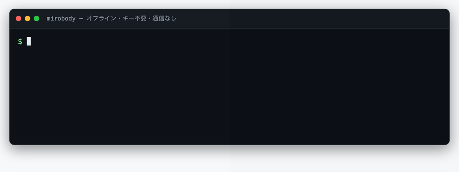

# クイックスタート

**[English](quickstart.md)** · **[中文](quickstart.zh-CN.md)** · **日本語**

コマンド1つでデータの標準化を試すか、アプリ全体を起動して、文書の処理と健康についての質問に使います。

| やりたいこと | ここから | 必要なもの |
| --- | --- | --- |
| ターミナルや Python でデータを標準化する | [ライブラリを使う](#a--the-library) | uv、または Python 3.12 以上。API キー不要 |
| ブラウザでアプリを試す | [Codespaces](#try-it-in-codespaces) | GitHub アカウントとモデル API キー |
| アプリとモデルを手元で動かす | [ローカル Docker](#run-it-100-locally) | Docker Compose。メモリ 16 GB（うち 8 GB を Docker に割り当て） |
| ソースから開発する | [ソースから開発](#c--a-checkout) | Python 3.12 以上、pgvector 付きの Postgres、モデル API キーまたはローカルモデルサーバー |

インストール前に合成の健康記録を見るには、[Mirobody Web デモ](https://chat.mirobody.ai/demo?ref=github-quickstart&lang=ja)を開いてください。

<a id="a--the-library"></a>

## A · ライブラリを使う

[uv をインストール](https://docs.astral.sh/uv/getting-started/installation/)したら、次を実行します。

```bash
uvx --python 3.12 mirobody resolve "LDL cholesterol" 血红蛋白 ヘモグロビン "空腹血糖(GLU)" 血脂
```

uv が必要に応じて Python と依存関係をダウンロードします。初回ダウンロードのあとは、名称と単位の解決はモデルも API キーもデータベースも使わず、オフラインで動きます。

<p align="center">
  
</p>

`血红蛋白` と `ヘモグロビン` は、どちらも LOINC `718-7` に解決されます。広い分類である `血脂` は、違う検査にコードを割り当てないよう、未解決のままになります。

Python 3.12 以上のプロジェクトでは、ライブラリをインストールします。

```bash
pip install mirobody
```

```python
from mirobody import resolve, resolve_reading

resolve("血红蛋白").loinc  # '718-7'
resolve_reading("total cholesterol", "5.0", "mmol/L").loinc  # '14647-2'
```

読数を解決するときは単位も渡してください。単位によって適用されるコードが変わることがあります。ベースのライブラリが依存するのは numpy だけです。Apple Health のエクスポートも読み込めます。

```bash
mirobody import apple ~/Downloads/export.zip
```

PDF、写真、表計算ファイルを読み込むには `pip install 'mirobody[parse]'` を実行し、モデル API キーを設定してください。MCP クライアントで使うには `uvx --python 3.12 mirobody mcp` を実行します。語彙ツールは stdio 上でオフラインのまま動き、文書を読み取るツール `standardize_report` だけ `[parse]` とモデルキーが必要です。主訴と診断のコーディング、単位の変換、FHIR 出力については [standardization.md](standardization.md)（英語）を、実行できる例は [`examples/`](../examples/README.md) を参照してください。

<a id="b--the-stack"></a>

## B · アプリ全体を起動する

アプリには Web クライアント、サーバー、ワーカー、そして pgvector 付きの Postgres が含まれます。クラウドかローカルか、好きな方法で始められます。

<a id="try-it-in-codespaces"></a>

### Codespaces で試す

[](https://codespaces.new/thetahealth/mirobody?quickstart=1)

codespace を作成し、ターミナルで自動セットアップが終わるのを待ちます。表示される HTTPS のセットアップリンクを開き、自分のモデル API キー（[OpenRouter](https://openrouter.ai/keys) や [OpenAI](https://platform.openai.com/api-keys) など）を入力します。セットアップページは実際のリクエストでキーを検証します。ポート `18060` は既定で非公開のまま転送されます。

アプリと記録は GitHub のクラウドに保存され、モデル処理に送る文書と質問は使用するモデル提供元に送られます。用意された合成データを試しに使ってください。[Codespaces の課金](https://docs.github.com/en/billing/concepts/product-billing/github-codespaces)とモデルの利用料がかかります。終わったら codespace を停止してください。再び開くとアプリも起動し直します。

<a id="run-it-100-locally"></a>

### 100% ローカルで動かす

Git、OpenSSL、Docker Compose をインストールしたら：

```bash
git clone --depth 1 https://github.com/thetahealth/mirobody.git && cd mirobody
COMPOSE_PROFILES=local-cpu ./deploy.sh
```

メモリ 16 GB のマシンを用意し、少なくとも 8 GB を Docker に割り当てます。GPU もモデル API キーも不要です。Windows では WSL 2 でこれらのコマンドを実行します。初回起動時にイメージとモデルの重みをダウンロードし、以降の文書処理とモデル処理は手元のマシンだけで行われます。CPU での応答には数分かかることがあります。Mac と GPU の設定は [local-models.ja.md](local-models.ja.md) を参照してください。

このスクリプトは `.env` にシークレットを生成し、ローカルモデルを選んで、アプリのリンクを表示します。ビルド済みイメージには LOINC のバンドルが含まれているため、Docker でのデプロイに Git LFS は不要です。

**クラウドのモデルを使うには、** ローカルプロファイルなしで `./deploy.sh` を実行します。`http://localhost:18060` のセットアップリンクを開き、モデル API キーを入力してください。記録は手元のマシンに残り、文書と質問はそのモデルサービスに送られます。

### ログインしてアップロードを試す

「メールコード」タブで `you@mirobody.ai`、コード `111111` でログインします。メールサービスは不要です。「コレステロールはどう変化した？」と聞いてから、「データ」ページで [`demo/upload/`](../demo/) の合成ファイルをアップロードしてください。これらのファイルは種子データに含まれていないため、アップロードすると文書処理を実際に試せます。

**実データを扱うデプロイを初めて起動する前に、`SEED_DEMO_DATA=false` を設定してください。** 設定しないと、公開された2つのデモアカウントが作成されます。

`.env` にモデルキーを置くこともできます：`OPENROUTER_API_KEY`、`OPENAI_API_KEY`、`GOOGLE_API_KEY`、`ANTHROPIC_API_KEY`。OpenAI 互換のゲートウェイを使うときは `<PROVIDER>_BASE_URL` を設定します。各エントリが読む変数名は [`config.llm.yaml`](../config.llm.yaml) にあります。シークレットはこのファイルではなく環境変数に保存してください。`.env` を変更したら `docker compose up -d` を実行します。`restart` では再読み込みされません。

選択されているモデルを確認し、それぞれにテストリクエストを送ります。

```bash
docker compose exec mirobody mirobody doctor --probe
```

<a id="c--a-checkout"></a>

## C · ソースから開発する

```bash
git clone --depth 1 https://github.com/thetahealth/mirobody.git && cd mirobody
git lfs install && git lfs pull
python3.12 -m venv .venv && . .venv/bin/activate
pip install -e '.[app]'
```

pgvector 付きの Postgres を起動するか、既存のインスタンスを使います。

```bash
docker run -d -p 5432:5432 -e POSTGRES_USER=user -e POSTGRES_PASSWORD=pw \
    -e POSTGRES_DB=mirobody \
    pgvector/pgvector:pg17
```

```bash
mirobody dev --pg-url postgres://user:pw@localhost:5432/mirobody
```

別のターミナルから：

```bash
curl -fsS http://127.0.0.1:18090/api/health
```

応答には `version` が含まれます。`dev` はリポジトリのルートから実行してください。そうすれば `frontend/` の Web クライアントも API と一緒に配信されます。Python パッケージ単体には Web クライアントは含まれません。

`dev` は一時的なシークレットを生成します。再起動をまたいでセッションと暗号化された設定を保持するには、`JWT_KEY` と `CONFIG_ENCRYPTION_KEY` を設定してください。`PG_ENCRYPTION_KEY` も設定してください。設定しないと、保存される記録の項目は `config.yaml` の公開されたプレースホルダーの鍵で暗号化されます（SECURITY.md）。デプロイでは `serve` が同梱の設定と `config.{ENV}.yaml` を読み込み、永続的なシークレットを前提とします。

Debian や Ubuntu では、Docker を使わずに `scripts/install_native.sh` が PostgreSQL、pgvector、Python 環境をインストールします。`scripts/start_native.sh` はワーカーとサーバーをポート 18060 で起動します。

<a id="when-it-does-not-come-up"></a>

## トラブルシューティング

| 症状 | 確認すること |
| --- | --- |
| モデルが利用できない | `./deploy.sh` が表示するセットアップリンクを開いてから、`mirobody doctor` を実行します。 |
| クローン直後のソースで LOINC の用語が解決できない | `git lfs pull` を実行してデータバンドルをダウンロードします。 |
| `dev` が Postgres を見つけられない | `--pg-url` を渡すか、`PG_URL` / `DATABASE_URL` を設定します。`serve` の場合は `PG_HOST`、`PG_PORT`、`PG_USER`、`PG_PASSWORD`、`PG_DBNAME` を設定します。 |
| デバイスの同期が動かない | ワーカーのログと Postgres の接続を確認します。 |
| Docker Hub に到達できない | `deploy.sh` が失敗を報告し、ミラー経由で再試行します。`.env` に `DOCKER_MIRROR=<registry>/` を設定すると、使うミラーを選べます。 |

<a id="next"></a>

## 次のステップ

デプロイには[セルフホストガイド](https://docs.mirobody.ai/ja/self-host)、アプリを一通り見るには [walkthrough.ja.md](walkthrough.ja.md)、Garmin、Oura、Whoop の接続には [provider-setup.md](provider-setup.md)（英語）を使ってください。開発については [repository-layout.md](repository-layout.md)（英語）と [pipeline.md](pipeline.md)（英語）を参照してください。
