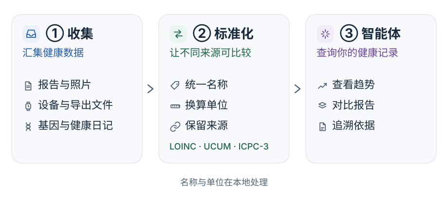

# 数据处理流程

Mirobody 将文件、设备数据和健康日记整理成统一记录，再供网页、agent 和 MCP 客户端查询。

<picture>
  <source media="(prefers-color-scheme: dark)" srcset="../images/collect-standardize-agent-dark.zh-CN.svg">
  
</picture>

## 从原始资料到回答

| 阶段 | 处理内容 |
| --- | --- |
| ① 收集 | 接收文件、设备数据和日记，保留原始来源。 |
| ② 标准化 | 为能够识别的指标确定标准编码，并转换兼容的单位。 |
| ③ 智能体 | 查询选中用户的记录，进行比较，并引用答案依据。 |

文件上传完成后，读数提取可能仍在进行，请以提取结果为准。
设备数据可以汇总为每日数值；查询结果会说明所用视图和日期范围。

## 数据准确性

- 无法识别的名称保留为未解析，不补写编码。
- 不兼容的单位分别保留，不强行合并为同一条趋势。
- 读数保留来源，方便回到原始文件核对。
- 记录被更正或移除后，后续查询和引用会反映变化。
- 没有记录不代表没有相关症状或疾病。

## 数据的处理位置

术语解析与单位转换离线完成。文档识别和对话由部署时选定的模型处理；使用云端模型时，
相应任务的数据会发送给服务商。本地、云端与混合方案的区别见[选择模型](../model-choice.zh-CN.md)。

开发者可查阅[完整处理管线说明](../pipeline.md)。
