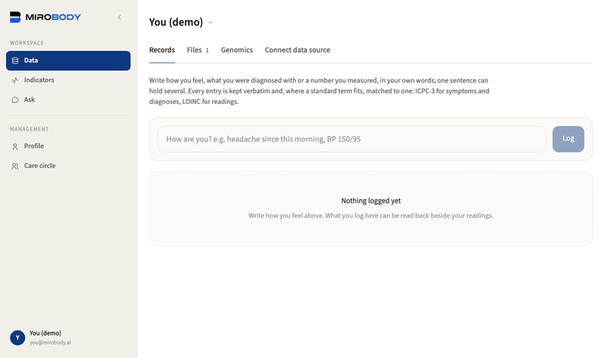
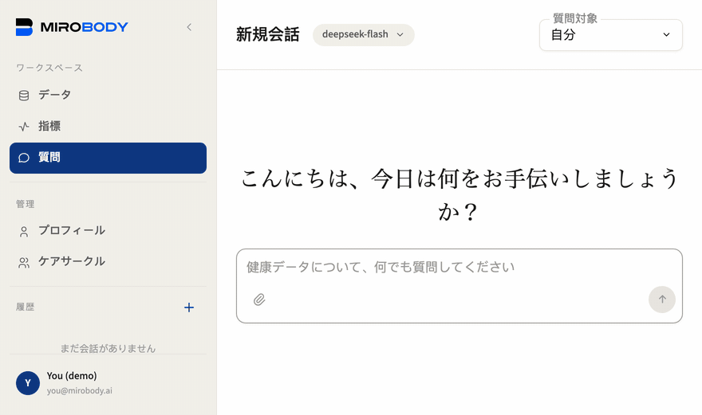
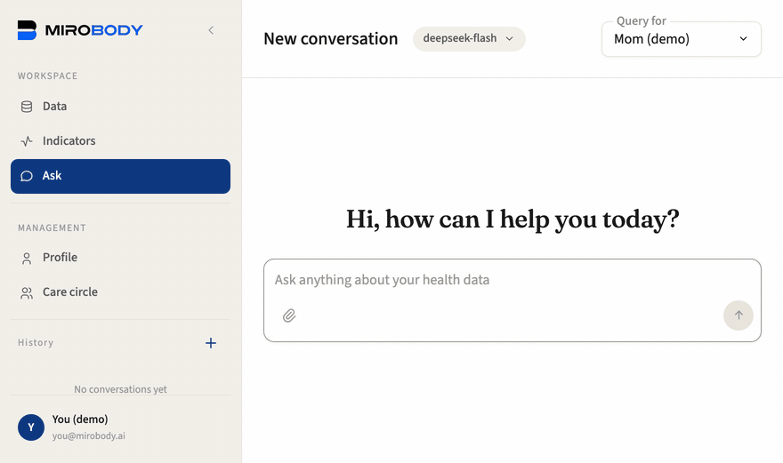
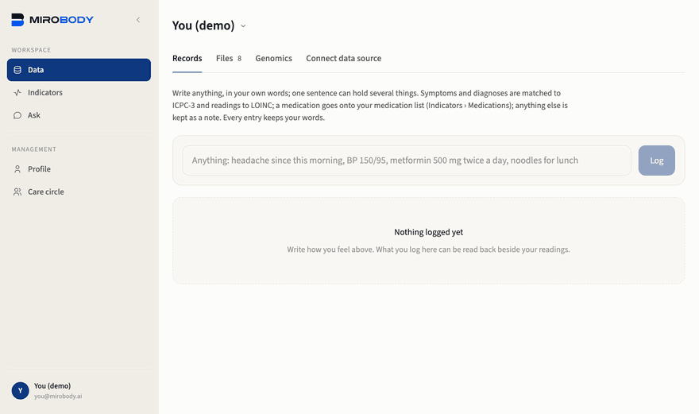

# 4分でたどるエンジンの全体像

**[English](walkthrough.md)** · **[中文](walkthrough.zh-CN.md)** · **日本語**

このページでは、デモの記録を使って5つの場面をたどります。ログイン、ファイルのアップロード、コード化された値の確認、複数の報告をまたいだ質問、そして日記をつけることです。2から5の場面は、`SEED_DEMO_DATA` を有効にして動かした `./deploy.sh` のスタックで録画したものです。1の場面は図解で、その裏にある認可ルールを図の下に挙げています。

`SEED_DEMO_DATA` は既定で有効なので、`./deploy.sh` が終わった時点で ① → ② → ③ の流れをすぐにたどれます。ログインして種子データの記録を見るだけならモデルは不要です。ファイルを読み取って質問に答えるときは、セットアップページで選んだモデル（キーまたは[ローカルモデル](local-models.ja.md)）を使います。

**1 · ログインする。** `you@mirobody.ai` でログインすると、記録が1つではなく2つ見つかります。自分の記録には、1年分の自己計測のバイタルと、昨年11月の検査パネルがあります。`mom@mirobody.ai` は同じ形の記録を持つ別人で、自分の記録を閲覧のみであなたに共有しています。その体重は増え続け、睡眠は短く、HbA1c は基準範囲を外れています。同じ質問に2つの答えがあり、2つの記録のうち自分のものは1つだけです。隔離は読んで理解するものではなく、目で見えるものです。

<p align="center">
  <picture>
    <source media="(max-width: 640px) and (prefers-color-scheme: dark)" srcset="images/care-circle-sharing-mobile-dark.ja.svg">
    <source media="(max-width: 640px)" srcset="images/care-circle-sharing-mobile.ja.svg">
    <source media="(prefers-color-scheme: dark)" srcset="images/care-circle-sharing-dark.ja.svg">
    <source media="(prefers-color-scheme: light)" srcset="images/care-circle-sharing.ja.svg">
    
  </picture>
</p>

<a id="the-four-promises"></a>

| ケアサークルの約束 | 保証する仕組み |
| --- | --- |
| 参加には本人の承諾が必要 | `status`。保留中は承諾済みではない |
| 健康データは許可するまで共有されない | `health_access`、`NOT NULL DEFAULT 0` |
| **あなた自身の**行にある、**あなたの**スイッチ | 管理するのはあなたの記録であり、相手の記録ではない |
| 各メンバーが自分の分だけを管理する | 他人の操作であなたの権限が上がることはない |

この4つはそれぞれ、セキュリティ特性としてテストに固定されています。

このスイッチは約束ではなく列です。`care_circle_members.health_access`、`NOT NULL DEFAULT 0`、**あなた自身の**行にあります。サークルに招待されただけでは何も共有されません。決めるのはメンバー本人で、他人の操作がそれを引き上げることはありません。これを読み取るチェックは偽値を返すのではなく例外を発生させるので、確認を忘れたルートは記録を渡す代わりに 403 を返します。[`examples/06_care_circle_rules.py`](../examples/06_care_circle_rules.py) は決定表全体をオフラインで表示します。

例外となるメンバーが1人だけいます。「ケアサークル管理」ページで追加する、自分ではログインしない親などです。そのアドレスは誰もログインできないプレースホルダーなので、そのスイッチはあなたが握り、読み書きできます。本人が自分でログインしたくなったら、カードから招待リンクを送ってください。本人が本当のアドレスを証明すると（そこに送られたコード、メールを送らないデプロイではパスワードで）、アカウントとその中身はすべて本人のものになり、編集・閲覧・なしのうちどれをあなたに残すかを本人が選びます。そのアドレスに既にアカウントがある場合は、記録はそちらに統合されます。

**2 · ① 収集。** [`demo/upload/`](../demo/) には、種子データがあえて含めていない4つのファイルがあり、アップロードは意味のある操作になります。しかも4つは別々の形式です。健康記録は、検査機関や診療所、家族がそれぞれ作った形のまま届くからです。

| ファイル | 形式 | 内容 | 指標数 |
| --- | --- | --- | --- |
| `you_annual_checkup_2026-05.pdf` | PDF | 今年のパネル検査、診療所が印刷したもの | 9 |
| `mom_physical_2026-06.jpg` | JPG | 印刷された用紙をスマートフォンで撮影した写真 | 9 |
| `you_lipid_panel_2026-08.csv` | CSV | 別の検査機関のエクスポート、独自の表記 | 5 |
| `mom_clinic_visit_2026-07.xlsx` | XLSX | 診療所が表計算ソフトに入力した内容 | 4 |

「データ」ページにファイルを1つ落とすと、そのファイルはまず原文のまま、追跡可能な形で保存されます。① 収集がすることはそれだけです。この切り分けが重要です。検査機関が何と言ったかは1つの事実であり、それが何を意味するかは別の話だからです。

<p align="center">
  
</p>

**3 · ② 標準化。** モデルがページを読み終えると（クラウドのモデルなら数秒、CPU だけなら数分）、その分析項目は測定値として出てきます。どれも読み取り元のファイルにリンクし、それぞれにコードが付きます。

```
Glycated Hemoglobin-HbA1c   5.2 %        loinc 4548-4
Fasting Blood Glucose-FBG   4.9 mmol/L   loinc 14771-0
Total Cholesterol-TC        4.45 mmol/L  loinc 14647-2
Low-Density Lipoprotein-LDL 2.48 mmol/L  loinc 22748-8
```

モデルはページを読みますが、コードを作り出すことはできません。コードの解決は同梱のバンドルに対する検索であり、オフラインかつ決定的で、答えがないときは推測せず棄権します。

このコードがあるからこそ、別々のファイルを一緒に読めます。この csv は別の検査機関のもので、分析項目の呼び方も違います。パネルが `Total Cholesterol-TC` と印字するところを、この csv は `Cholesterol, Total` と記しますが、どちらも 14647-2 なので、2つではなく1つの系列になります。単位はなめらかに均されるものではなく、この識別の一部です。コレステロールは mmol/L では 14647-2、mg/dL では 2093-3 であり、そう言い切ることが、2つの単位を混ぜたトレンドが気づかれずに狂うのを防ぎます。この2つのコードを1本の比較可能な線にまとめるのが 1.5.0 の comparability key です。デバイス側ではすでにこの変換が行われており、[`examples/02_standardize_a_reading.py`](../examples/02_standardize_a_reading.py) はオフラインで `154.5 lb` を `70.08 kg` に変換します。

**4 · ③ エージェント。** コレステロールがどう動いたか聞いてみます。処理中は、取っているステップ（「健康データを検索中」「ファイルを読んでいます」）が推論と並んで表示され、終わると折りたたまれます。エージェントはその検査が載っているファイルをすべて見つけ出し、csv の別表記も含めて、読み取った内容から答えます。

```
Total Cholesterol   4.60 mmol/L   2025-11-12   you_lab_2025-11.md
                    4.45 mmol/L   2026-05-06   2026-05-06_Annual_Physical_Exam_Report.pdf
                    4.38 mmol/L   2026-08-04   you_lipid_panel_2026-08.csv
```

3つのファイル、3つの書き方、1本の線。引用された数値はどれも点線の下線が付いていて、クリックすると測定値と日付、基準範囲、出どころのファイルが横に開きます。共有された記録に同じ質問をすると、答えは別の人のものになります。

<p align="center">
  
</p>

<p align="center">
  
</p>

**5 · 日記をつける。** 「データ › 記録」で、一文を入力します：`headache since last night, BP 150/95, no fever, metformin 500 mg morning and evening`（昨夜から頭痛、血圧 150/95、熱なし、メトホルミン500mgを朝晩）。モデルがこれを分解し、それぞれの部分を書き込みます。コードは語彙から決まります。これは NS01 のコードが付いた頭痛、8480-6 と 8462-4 のコードが付いた血圧、そして服薬リストに加わるメトホルミンになります。「no fever」が発熱として記録されることはありません。

<p align="center">
  
</p>

これが一度に完結する全体の流れです。ファイルが入り、コード化された測定値が出て、エージェントがそれをもとに答えます。収集（Collect）・標準化（Standardize）・エージェント（Agent）の各段階が、主張ではなく、それぞれ単独で目に見える形になっています。

すべての値は生成されたものです。ここにあるどのファイルも実在の人物を記述しておらず、この種子データにはネットワークもキーも要りません。実データを保持するデプロイでは `SEED_DEMO_DATA=false` を設定してください。各ファイルが何であり、どう再生成するかは [`demo/README.md`](../demo/README.md) に、抽出処理がこれらの測定値に対して**まだ**行っていないことは、曖昧にせずそのまま [docs/roadmap.md](roadmap.md)（英語）に書いています。

---
